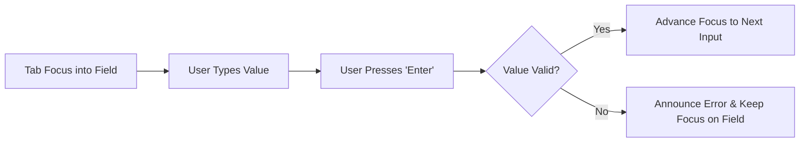

# ♿ VitaGuard AI — Accessibility Audit & WCAG 2.2 AA Compliance Plan (Phase 02)
**Project:** TriNexus | VitaGuard AI  
**Benchmark:** WCAG 2.2 Level AA (Web Content Accessibility Guidelines)  
**Target Users:** Elderly Citizens, Visually Impaired, Color-Blind, Low-Digital-Literacy Android Users  
**Date:** November 2026

---

## 1. Executive Accessibility Findings

An audit of the existing React/Tailwind frontend against **WCAG 2.2 Level AA** standards identified significant gaps in visual contrast, keyboard navigation, touch targets, and assistive technology support:

| WCAG 2.2 Criterion | Current Status | Primary Deficiencies Identified | Severity |
|---|:---:|---|:---:|
| **1.1.1 Non-text Content** | **FAIL** | SVGs and icons lack `aria-hidden="true"` or `aria-label`; HeartGraphic is purely decorative but unflagged. | HIGH |
| **1.3.1 Info and Relationships** | **PARTIAL** | Tables in Dashboard and Evaluation lack `<caption>` or `<th scope="col">`. Form inputs lack explicit `<label htmlFor="...">`. | HIGH |
| **1.4.1 Use of Color** | **FAIL** | Risk levels (Red/Amber/Green) and SHAP bars rely strictly on color to convey directionality without supporting text. | CRITICAL |
| **1.4.3 Contrast (Minimum)** | **PARTIAL** | Muted text (`text-gray-400`, `text-slate-400`) on white backgrounds yields 2.8:1 contrast (below 4.5:1 requirement). | HIGH |
| **2.1.1 Keyboard Navigation** | **PARTIAL** | Interactive cards and tab selectors (`<div>` with `onClick`) lack `tabIndex="0"` and keyboard `Enter`/`Space` listeners. | HIGH |
| **2.4.7 Focus Visible** | **FAIL** | Default browser focus outlines are suppressed via `focus:outline-none` without replacement `focus:ring-2` on buttons. | HIGH |
| **2.5.5 Target Size (Enhanced)** | **FAIL** | Multiple desktop links and table action buttons have tap heights of 28px–32px (fails minimum 44px x 44px). | CRITICAL |
| **3.1.2 Language of Parts** | **FAIL** | Bilingual pages mix English and Bengali text within the same DOM nodes without `lang="bn"` attributes for screen readers. | MEDIUM |
| **4.1.3 Status Messages** | **FAIL** | Async error banners and form submission notifications lack `role="alert"` or `aria-live="polite"`. | HIGH |

---

## 2. Granular Remediation Blueprint

### 2.1 Color Contrast Remediation
All muted gray tokens must be upgraded to comply with the 4.5:1 ratio for normal text:
* **Current Fail:** `text-gray-400` (`#9CA3AF`) on White = **2.1:1** ❌
* **Current Border:** `border-gray-200` (`#E5E7EB`) on White = **1.3:1** (Barely visible for elderly eyes)
* **Remediation:**
  * Upgrade all primary body and instructional text to `text-slate-900` (`#0F172A`) or `text-slate-800` (`#1E293B`) (**13:1+**).
  * Upgrade secondary/muted text to `text-slate-600` (`#475569`) (**5.8:1** - Passes AAA).
  * Upgrade card borders to `border-slate-300` (`#CBD5E1`) for distinct card separation.

### 2.2 Triple-Encoded Clinical Visuals (Eliminating Color-Alone Reliance)
To accommodate the ~8% of male patients in Bangladesh who have red-green color vision deficiency:
1. **Risk Badges:**
   * High Risk: Color `#DC2626` + `AlertOctagon` icon (Octagon with exclamation) + Text "উচ্চ ঝুঁকি (High Risk)".
   * Moderate Risk: Color `#D97706` + `AlertTriangle` icon (Warning triangle) + Text "মাঝারি ঝুঁকি (Moderate Risk)".
   * Low Risk: Color `#15803D` + `CheckCircle2` icon (Checkmark in circle) + Text "কম ঝুঁকি (Low Risk)".
2. **SHAP Feature Importance Bars:**
   * Risk-increasing factors: Tagged with `[+]` prefix, upward arrow `▲`, and text badge "ঝুঁকি বৃদ্ধি".
   * Protective factors: Tagged with `[-]` prefix, downward arrow `▼`, and text badge "সুরক্ষামূলক".

### 2.3 Touch Target & Mobile Usability Standard
* **48px x 48px Minimum Tap Area:** All mobile buttons, select inputs, radio cards, and navigation links must enforce a minimum height of `48px` (`h-12`).
* **Adequate Tap Spacing:** Interactive sibling elements must maintain at least `8px` gap to prevent erroneous double-taps by patients with tremors.

### 2.4 Bengali Typography & Screen Reader Optimization
1. **Bengali Font Rendering:**
   * Default system fonts on older Android devices often clip Bengali vowel conjuncts (*hoshonto*, *kar*, *juktakkhor*).
   * Webfont integration with `Noto Sans Bengali` ensures uniform glyph rendering across Walton, Symphony, and Samsung devices.
2. **Screen Reader Landmarks & ARIA Live Regions:**
   * Main content wrapped in `<main role="main">`.
   * Form step progress declared using `aria-current="step"`.
   * Dynamic screening results wrapped in `<div role="region" aria-live="polite">` so screen readers automatically announce: "আপনার স্ক্রিনিং সম্পন্ন হয়েছে। প্রাথমিক ফলাফল: স্বাভাবিক বা কম ঝুঁকি।"
3. **Screen Reader Text Alternative for SHAP:**
   * Below the visual SHAP bar chart, provide a visually hidden accessible data table `<table className="sr-only">` listing each feature, measured value, and its numerical contribution.

---

## 3. Keyboard Navigation & Tab Order Architecture

All multi-step forms and modal dialogs must support 100% keyboard navigation without mouse dependence:



* **Visible Focus Indicator Standard:**
  ```css
  /* Mandatory on all interactive elements */
  @apply focus:outline-none focus:ring-2 focus:ring-teal-600 focus:ring-offset-2;
  ```
* **Modal Dialog Focus Trapping:** When the "Doctor Review" or "Appointment Booking" modal opens, focus must automatically trap inside the modal, and pressing `Escape` must close the modal without page reload.
