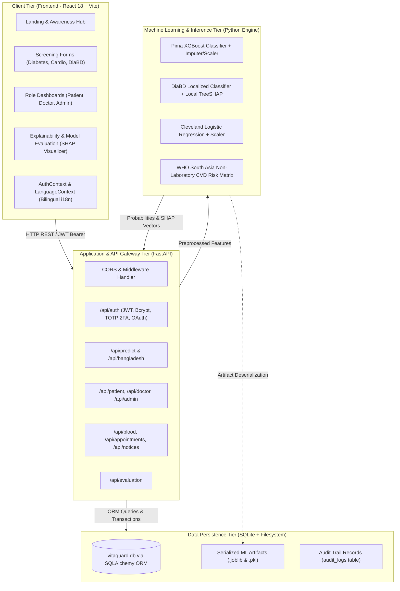
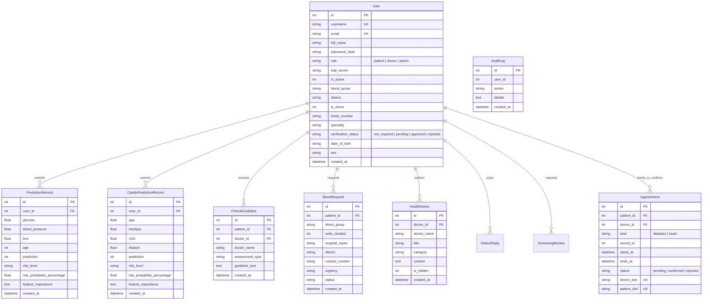
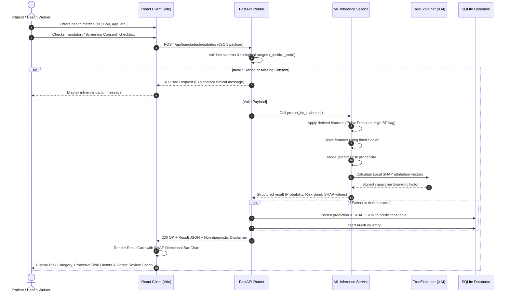

# 🏛️ VitaGuard AI — System Architecture Overview (Phase 01)
**Project Identity:** TriNexus | VitaGuard AI  
**Focus:** Explainable Clinical Decision Support System (CDSS) for Bangladesh  
**Date:** November 2026

---

## 1. System Topology & Tier Architecture

VitaGuard AI is structured as a decoupled multi-tier architecture designed for low-latency clinical inference, patient data security, and verifiable AI transparency:

---

## 2. Database Schema & Entity-Relationship Model

The application utilizes **SQLAlchemy 2.0 ORM** connected to a local SQLite database (`backend/vitaguard.db`). The schema encompasses 10 core entities supporting clinical records, appointments, health notices, and auditing:

---

## 3. End-to-End Clinical Screening Sequence

The following sequence illustrates the strict validation, ethical screening consent, ML inference, and XAI explanation lifecycle:

---

## 4. Machine Learning Inference & Provenance Pipeline

The machine learning environment operates with explicit model isolation:

1. **Model Persistence Directory:**
   - Global models reside in `ML_Model/models/` (`best_model.pkl`, `scaler.pkl`, `imputer.pkl`).
   - Bangladesh and cardiac models reside in `backend/app/ml_models/` (`bd_diabetes.joblib`, `cardio_model.joblib`, `cardio_scaler.joblib`).
2. **Provenance & Integrity Verification:**
   - Training scripts compute SHA-256 hashes of training datasets and resulting models, recorded in `ML_Model/evaluation/metrics.json`.
3. **Data Preprocessing Safety:**
   - To prevent data leakage, imputers and standard scalers are fitted strictly on training folds and frozen for production inference.
   - Biological zero handling: Clinical measurements where zero is physiologically impossible (Glucose, BP, Insulin, BMI) are converted to `NaN` prior to imputation.

---

## 5. Security & Authentication Architecture

1. **Role-Based Access Control (RBAC):**
   - Three distinct roles: `patient`, `doctor`, `admin`.
   - Role enforcement is applied at both frontend (`ProtectedRoute.jsx`) and backend router levels (`get_current_user`, `_approved_doctor`).
2. **Two-Factor Authentication (TOTP):**
   - Mandatory for administrative users. Admin credentials include a 32-character base32 secret. Logins require generating valid 6-digit TOTP tokens synchronized with RFC 6238.
3. **Doctor Verification Workflow:**
   - Doctors register with their BMDC registration number and specialty. Accounts are placed in `pending` status until verified by an Administrator in the Admin Dashboard.
4. **Input Sanitization & Clinical Integrity:**
   - All user inputs destined for public display (Health Notices, Doctor Advice, Appointment Notes) are sanitized through `_plain()`, stripping HTML tags and ASCII control characters to prevent Cross-Site Scripting (XSS).
