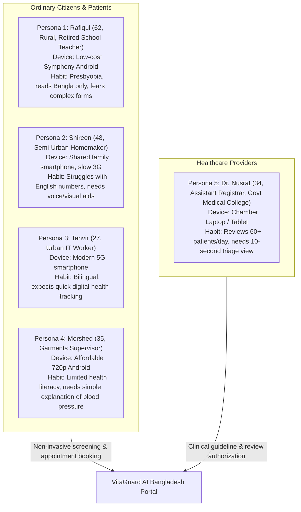

# 🇧🇩 VitaGuard AI — Bangladesh-First Patient Experience Framework (Phase 02)
**Project:** TriNexus | VitaGuard AI  
**Focus:** Cultural, Linguistic, Cognitive, and Technological Adaptation for Bangladesh Healthcare  
**Date:** November 2026

---

## 1. Demographic & User Persona Archetypes

To ensure clinical effectiveness, VitaGuard AI is designed around nine realistic personas reflecting the socioeconomic and digital reality of Bangladesh:



---

## 2. Linguistic Adaptation & Plain Medical Bangla

### 2.1 The Danger of Literal Translation in Healthcare
Literal machine translations often produce absurd or frightening phrases. In medical contexts, clarity, empathy, and dignity are essential:

| Medical Term | Bad Machine Translation | **VitaGuard Clinical Bangla (Recommended)** | Clinical Context / Explanatory Note |
|---|---|---|---|
| Screening | ছাঁকনি / বাছাইকরণ | **প্রাথমিক স্বাস্থ্য ঝুঁকি পরীক্ষা** | Clarifies it is a risk test, not diagnosis |
| Clinical Decision Support | ক্লিনিক্যাল সিদ্ধান্ত সহায়তা | **ডাক্তারদের সিদ্ধান্ত গ্রহণে সহায়ক প্রযুক্তি** | Clarifies AI aids the doctor |
| Diabetes Pedigree Function | ডায়াবেটিস বংশতালিকা অপেক্ষক | **পারিবারিক ডায়াবেটিসের ইতিহাস** | Relates to family genetics simply |
| ST Depression | এসটি অবনমন | **ইসিজি (ECG) পরীক্ষার বিশেষ পরিবর্তন** | Accessible to patients without cardiology degree |
| Fasting Blood Sugar | রোজা রক্তে চিনি | **খালি পেটে রক্তের গ্লুকোজ / সুগার** | Matches laboratory report vocabulary |
| Systolic Blood Pressure | সিস্টোলিক চাপ | **রক্তচাপের উপরের মাত্রা (Systolic)** | Universal Bengali doctor-patient phrasing |
| Diastolic Blood Pressure | ডায়াস্টোলিক চাপ | **রক্তচাপের নিচের মাত্রা (Diastolic)** | Universal Bengali doctor-patient phrasing |
| Feature Importance | বৈশিষ্ট্যের গুরুত্ব | **ঝুঁকি বাড়ানো বা কমানোর কারণসমূহ** | Immediately understandable impact |
| High Risk | উচ্চ ঝুঁকি | **উচ্চ ঝুঁকি (ডাক্তারের পরামর্শ প্রয়োজন)** | Avoids panic; immediately directs to action |
| Moderate Risk | মাঝারি ঝুঁকি | **মাঝারি ঝুঁকি (নিয়মিত নজরদারি প্রয়োজন)** | Reassuring yet watchful |
| Low Risk | কম ঝুঁকি | **স্বাভাবিক / কম ঝুঁকি (সুস্থ জীবনধারা বজায় রাখুন)**| Encourages preventive lifestyle |

---

## 3. Numerals, Units, Dates & Formatting

### 3.1 Numeral Handling (English vs. Bengali Digits)
* **The Reality in Bangladesh:** While the Bengali script is used for prose, almost all official diagnostic laboratory reports (Popular Diagnostic, Ibn Sina, Labaid), digital glucometers (Accu-Chek), and electronic BP monitors display **Western Arabic numerals (0, 1, 2, 3...)**.
* **Design Standard:**
  * **Form Input Fields:** Accept English numerals (`120`, `80`) and automatically transliterate Bengali numerals (`১২০`, `৮০`) on typing to prevent form submission validation errors.
  * **Display Numbers:** Display standard English digits for medical lab values (`120/80 mmHg`, `5.8 mmol/L`) while displaying date/time in full Bangla format.

### 3.2 Medical Measurement Units in Bangladesh
* **Blood Glucose:** In Bangladesh, laboratories and home glucometers measure blood sugar in **mmol/L** (British/International standard), whereas international models like Pima use **mg/dL** (US standard).
  * *VitaGuard Implementation:* The UI must provide a **smart toggle or dual display**:
    $$\text{Glucose (mmol/L)} \times 18 = \text{Glucose (mg/dL)}$$
    Example: `7.0 mmol/L (126 mg/dL)` ensures patients reading their local prescription report don't enter 7 into a field expecting 126!
* **Blood Pressure:** Displayed strictly in `mmHg` with common guidance: "উপরের প্রেশার (যেমন ১২০)" and "নিচের প্রেশার (যেমন ৮০)".
* **Weight & Height:** Offer both Kg / Cm and Feet-Inches / Kg conversions with automatic BMI calculation.

### 3.3 National Emergency & Telemedicine Integration
Whenever elevated risk is detected or critical vitals are inputted, provide official Bangladesh national health hotlines:
* 🩺 **স্বাস্থ্য বাতায়ন (Shastho Batayon):** `16263` (24/7 Government Telemedicine)
* 🚑 **জাতীয় জরুরি সেবা (National Emergency):** `999` (Ambulance & Emergency)
* 🩸 **রেড ক্রিসেন্ট ব্লাড ব্যাংক (Red Crescent):** `+88029330188`

---

## 4. Mobile & Low-Bandwidth Optimization for Rural Bangladesh

### 4.1 Sub-$100 Android Smartphones
Over 75% of rural mobile internet users in Bangladesh operate devices like Walton Primo, Symphony, or entry-level Xiaomi phones with:
- Screen widths of **360px to 384px**.
- Low RAM (2GB to 3GB) and aggressive background process termination.
- Screen scaling (large system fonts set by elderly users).

### 4.2 Low-Bandwidth UI Guidelines
1. **Touch Target Size:** Minimum **48px x 48px** for all interactive buttons to accommodate elderly thumbs and shaking hands.
2. **Numeric Keypad by Default:** All clinical inputs must carry `inputMode="numeric"` or `inputMode="decimal"` and `pattern="[0-9]*"`, immediately launching the number keypad instead of the full alphabetic QWERTY keyboard.
3. **Optimized SVG Icons:** Zero heavy raster imagery; lightweight Lucide SVGs embedded inline.
4. **Offline Resilience:** Form state preserved in `sessionStorage` so if a mobile connection drops momentarily, the patient does not lose their multi-step inputs.

---

## 5. Printable Clinical Diagnostic Summary (Chamber / Pharmacy Report)

In rural and semi-urban Bangladesh, patients frequently visit the local pharmacy or community healthcare worker (CHW). VitaGuard AI includes a **Print-Friendly Clinical Summary** template:

```
┌────────────────────────────────────────────────────────────────────────┐
│  🩺 TRINEXUS | VITAGUARD AI — প্রাথমিক স্বাস্থ্য ঝুঁকি মূল্যায়ন রিপোর্ট    │
│  তারিখ: ১০ নভেম্বর ২০২৬ | রোগী আইডি: #VG-8492 | বয়স: ৫৪ | লিঙ্গ: পুরুষ    │
├────────────────────────────────────────────────────────────────────────┤
│  পরীক্ষার ধরণ: ডায়াবেটিস ও হৃদরোগ ঝুঁকি স্ক্রিনিং (নন-ইনভেসিভ)               │
│                                                                        │
│  [ ফলাফল সংক্ষেপ ]                                                      │
│  • ডায়াবেটিস ঝুঁকি: মাঝারি (ঝুঁকি সম্ভাবনা: ৪২%)                          │
│  • হৃদরোগ ঝুঁকি (WHO 10-Year CVD Chart): কম (১০% এর নিচে)               │
│                                                                        │
│  [ রোগীর শারীরিক পরিমাপসমূহ ]                                           │
│  • রক্তচাপ: ১৩৫/৮৫ mmHg (সামান্য উচ্চ)                                  │
│  • বিএমআই (BMI): ২৭.৪ (অতিরিক্ত ওজন)                                   │
│  • পারিবারিক ডায়াবেটিসের ইতিহাস: হ্যাঁ                                  │
│                                                                        │
│  [ প্রধান প্রভাবকসমূহ (AI ব্যাখ্যা) ]                                    │
│  ▲ রক্তচাপ ১৩৫ mmHg (+১২% ঝুঁকি বৃদ্ধি করেছে)                           │
│  ▲ পারিবারিক ইতিহাস (+১৫% ঝুঁকি বৃদ্ধি করেছে)                           │
│  ▼ নিয়মিত হাঁটাহাঁটি (-৮% ঝুঁকি কমিয়েছে)                                │
│                                                                        │
│  [ চিকিৎসকের জন্য বিশেষ দ্রষ্টব্য ]                                      │
│  এই রিপোর্টটি প্রাথমিক এআই স্ক্রিনিং ভিত্তিক, কোনো চূড়ান্ত রোগ নির্ণয় নয়। │
│  দয়া করে রোগীর HbA1c এবং লিপিড প্রোফাইল পরীক্ষা করানোর পরামর্শ দিন।       │
│                                                                        │
│  জরুরি যোগাযোগ: স্বাস্থ্য বাতায়ন ১৬২৬৩ | জরুরি সেবা ৯৯৯                │
└────────────────────────────────────────────────────────────────────────┘
```
