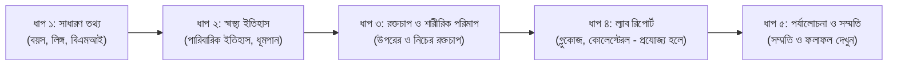

# 📝 VitaGuard AI — Clinical Assessment Wireframe & Multi-Step Wizard Specification (Phase 02)
**Project:** TriNexus | VitaGuard AI  
**Scope:** Multi-Step Guided Clinical Intake Form for Bangladesh Patients  
**Date:** November 2026

---

## 1. Multi-Step Wizard Architecture

To eliminate cognitive fatigue and reduce input error rates, all clinical assessments (Diabetes, Cardio, and DiaBD Bangladesh Screening) are structured into a 5-step guided wizard:



---

## 2. Granular Input Field Specifications

| Step | Field Name | Visual Label (BN / EN) | Unit | Input Type / Mode | Acceptable Range | Real-Time Help Text & Clinical Rule | Error Message (Bangla) |
|---|---|---|---|---|---|---|---|
| **1** | `age` | আপনার বয়স<br>(Age) | বছর (Years) | `inputMode="numeric"` | 21 – 80 (DiaBD)<br>40 – 74 (WHO CVD) | "জাতীয় পরিচয়পত্র বা জন্মনিবন্ধন অনুযায়ী সঠিক বয়স দিন।" | "বয়স ২১ থেকে ৮০ বছরের মধ্যে হতে হবে।" |
| **1** | `sex` | লিঙ্গ<br>(Sex) | — | Radio Pills | `male`, `female` | "চিকিৎসা সংক্রান্ত গবেষণায় জৈবিক লিঙ্গ নির্বাচন করুন।" | "অনুগ্রহ করে লিঙ্গ নির্বাচন করুন।" |
| **1** | `height` & `weight` or `bmi` | উচ্চতা ও ওজন / বিএমআই<br>(BMI) | kg/m² | `inputMode="decimal"` | 14.0 – 50.0 | "উচ্চতা ও ওজন দিলে বিএমআই স্বয়ংক্রিয়ভাবে হিসাব হবে।" | "বিএমআই ১৪ থেকে ৫০ এর মধ্যে হওয়া স্বাভাবিক।" |
| **2** | `family_diabetes` | পরিবারে ডায়াবেটিসের ইতিহাস<br>(Family History) | — | Toggle Button (হ্যাঁ / না) | `0` or `1` | "আপনার মা, বাবা বা ভাই-বোনের ডায়াবেটিস আছে কি না।" | "পারিবারিক ইতিহাস নির্বাচন করুন।" |
| **2** | `smoker` | ধূমপানের অভ্যাস<br>(Smoking Status) | — | Toggle Button (হ্যাঁ / না) | `0` or `1` | "বর্তমানে নিয়মিত বিড়ি বা সিগারেট খান কি না।" | "ধূমপানের তথ্য দিন।" |
| **2** | `prior_cvd` | পূর্বে হার্ট অ্যাটাক বা স্ট্রোকের ইতিহাস | — | Toggle Button (হ্যাঁ / না) | `0` or `1` | "যদি পূর্বে হার্ট অ্যাটাক হয়ে থাকে, তবে সরাসরি ডাক্তারের শরণাপন্ন হোন।" | "পূর্বে হার্ট অ্যাটাক থাকলে এই স্ক্রিনিং প্রযোজ্য নয়।" |
| **3** | `systolic_bp` | রক্তচাপের উপরের মাত্রা<br>(Systolic BP) | mmHg | `inputMode="numeric"` | 80 – 220 mmHg | "প্রেসক্রিপশন বা ডিজিটাল প্রেশার মেশিনের উপরের রিডিং (যেমন ১২০)।" | "সিস্টোলিক রক্তচাপ ৮০ থেকে ২২০ এর মধ্যে দিন।" |
| **3** | `diastolic_bp`| রক্তচাপের নিচের মাত্রা<br>(Diastolic BP) | mmHg | `inputMode="numeric"` | 50 – 130 mmHg | "প্রেসক্রিপশন বা মেশিনের নিচের রিডিং (যেমন ৮০)।" | "নিচের প্রেশার উপরের প্রেশার থেকে কম হতে হবে।" |
| **4** | `glucose` | রক্তের গ্লুকোজ / সুগার<br>(Glucose Level) | mmol/L or mg/dL | `inputMode="decimal"` | 2.5 – 11.0 mmol/L<br>(44 – 199 mg/dL) | "খালি পেটে বা ২ ঘণ্টা পরের সুগার রিপোর্ট থাকলে দিন। না থাকলে নন-ইনভেসিভ স্ক্রিনিং বেছে নিন।" | "গ্লুকোজের মাত্রা গ্রহণযোগ্য সীমার বাইরে।" |
| **5** | `consent` | স্ক্রিনিং সম্মতি ও স্বীকৃতি | — | Checkbox | `true` only | "আমি স্বীকার করছি এটি একটি প্রাথমিক ঝুঁকি অনুমান, কোনো চূড়ান্ত চিকিৎসা বা প্রেসক্রিপশন নয়।" | "মূল্যায়ন শুরু করতে সম্মতি প্রদান আবশ্যক।" |

---

## 3. Desktop Wireframe (Multi-Step Form)

```
┌────────────────────────────────────────────────────────────────────────────────────────┐
│  [Logo] VitaGuard AI        মূল্যায়ন    রক্তদান নেটওয়ার্ক    স্বাস্থ্য নোটিশ    [বাংলা/EN]   [User: তানভীর ▼] │
├────────────────────────────────────────────────────────────────────────────────────────┤
│                                                                                        │
│  ┌──────────────────────────────────────────────────────────────────────────────────┐  │
│  │  🩺 বাংলাদেশ নন-ইনভেসিভ ডায়াবেটিস ও হৃদরোগ ঝুঁকি মূল্যায়ন                          │  │
│  │  কোনো রক্ত পরীক্ষা ছাড়াই ঘরে বসে ২ মিনিটে প্রাথমিক স্বাস্থ্য ঝুঁকি জানুন।          │  │
│  │                                                                                  │  │
│  │  [ ১. তথ্য ] ──────●────── [ ২. ইতিহাস ] ────────── [ ৩. রক্তচাপ ] ────────── [ ৪. সম্মতি ]│  │
│  │    (সম্পন্ন)                  (বর্তমান ধাপ)                                          │  │
│  └──────────────────────────────────────────────────────────────────────────────────┘  │
│                                                                                        │
│  ┌──────────────────────────────────────────────────────────────────────────────────┐  │
│  │  ধাপ ২: পারিবারিক ও জীবনযাত্রার তথ্য (Family & Lifestyle History)                  │  │
│  │                                                                                  │  │
│  │  ১. আপনার পরিবারে কি কারও ডায়াবেটিস আছে? (বাবা, মা, ভাই, বোন)                   │  │
│  │     ┌────────────────────────┐      ┌────────────────────────┐                   │  │
│  │     │       [✓] হ্যাঁ         │      │          না            │                   │  │
│  │     └────────────────────────┘      └────────────────────────┘                   │  │
│  │     সহায়ক তথ্য: রক্ত সম্পর্কের কারও ডায়াবেটিস থাকলে জিনগত ঝুঁকি বৃদ্ধি পায়।      │  │
│  │                                                                                  │  │
│  │  ২. আপনি কি নিয়মিত ধূমপান বা তামাক ব্যবহার করেন?                                │  │
│  │     ┌────────────────────────┐      ┌────────────────────────┐                   │  │
│  │     │           হ্যাঁ        │      │       [✓] না           │                   │  │
│  │     └────────────────────────┘      └────────────────────────┘                   │  │
│  │                                                                                  │  │
│  │  ৩. আপনার কি পূর্বে কখনও হার্ট অ্যাটাক বা স্ট্রোক হয়েছে?                         │  │
│  │     ┌────────────────────────┐      ┌────────────────────────┐                   │  │
│  │     │           হ্যাঁ        │      │       [✓] না           │                   │  │
│  │     └────────────────────────┘      └────────────────────────┘                   │  │
│  │                                                                                  │  │
│  │  ──────────────────────────────────────────────────────────────────────────────  │  │
│  │  [ ← পূর্ববর্তী ধাপ ]                                    [ পরবর্তী ধাপ: রক্তচাপ → ] │  │
│  └──────────────────────────────────────────────────────────────────────────────────┘  │
│                                                                                        │
└────────────────────────────────────────────────────────────────────────────────────────┘
```

---

## 4. Mobile Wireframe (Single-Hand Touch Layout)

```
┌───────────────────────────────────────┐
│ [←] স্বাস্থ্য ঝুঁকি মূল্যায়ন   [BN/EN] │
├───────────────────────────────────────┤
│                                       │
│ ধাপ ৩ এর ৪: রক্তচাপ পরিমাপ (Blood Pressure)│
│ [████████████████░░░░░░] ৭৫% সম্পন্ন │
│                                       │
│ ┌───────────────────────────────────┐ │
│ │ উপরের রক্তচাপ (Systolic)          │ │
│ │ ┌───────────────────┬───────────┐ │ │
│ │ │ 120               │ mmHg      │ │ │
│ │ └───────────────────┴───────────┘ │ │
│ │ প্রেসক্রিপশন বা মেশিনের উপরের রিডিং  │ │
│ └───────────────────────────────────┘ │
│                                       │
│ ┌───────────────────────────────────┐ │
│ │ নিচের রক্তচাপ (Diastolic)         │ │
│ │ ┌───────────────────┬───────────┐ │ │
│ │ │ 80                │ mmHg      │ │ │
│ │ └───────────────────┴───────────┘ │ │
│ │ প্রেসক্রিপশন বা মেশিনের নিচের রিডিং  │ │
│ └───────────────────────────────────┘ │
│                                       │
│ [✓] উভয় রক্তচাপ স্বাভাবিক সীমার মধ্যে।│
│                                       │
│                                       │
│ ┌───────────────────────────────────┐ │
│ │ [ পরবর্তী ধাপ: সম্মতি দিন → ]     │ │
│ │ (উচ্চতা: ৪৮ পিক্সেল, সহজ স্পর্শ)    │ │
│ └───────────────────────────────────┘ │
│                                       │
│   [ ← আগের ধাপে ফিরুন ]               │
│                                       │
└───────────────────────────────────────┘
```

---

## 5. Defensive Input & Clashing Logic Rules

1. **Blood Pressure Clash Prevention:**
   * Rule: `Diastolic BP` must be strictly lower than `Systolic BP` with at least a 15 mmHg gap.
   * UX Behavior: If a user enters Systolic 80 and Diastolic 120, an immediate inline alert displays: *"রক্তচাপের নিচের মাত্রা উপরের মাত্রা থেকে বেশি হতে পারে না। অনুগ্রহ করে সঠিক মান দিন।"* The Next button is disabled until corrected.
2. **Prior CVD Lockout for WHO Chart:**
   * Rule: The WHO South Asia 10-year chart is scientifically validated *only* for primary prevention (patients with no prior cardiovascular event).
   * UX Behavior: If `prior_cvd === 1`, the chart lookup is withheld and a clinical alert displays: *"যেহেতু আপনার পূর্বে হার্ট অ্যাটাক বা স্ট্রোকের ইতিহাস রয়েছে, সাধারণ স্ক্রিনিং চার্ট আপনার জন্য প্রযোজ্য নয়। অনুগ্রহ করে একজন হৃদরোগ বিশেষজ্ঞের (Cardiologist) সাথে সরাসরি যোগাযোগ করুন।"*
