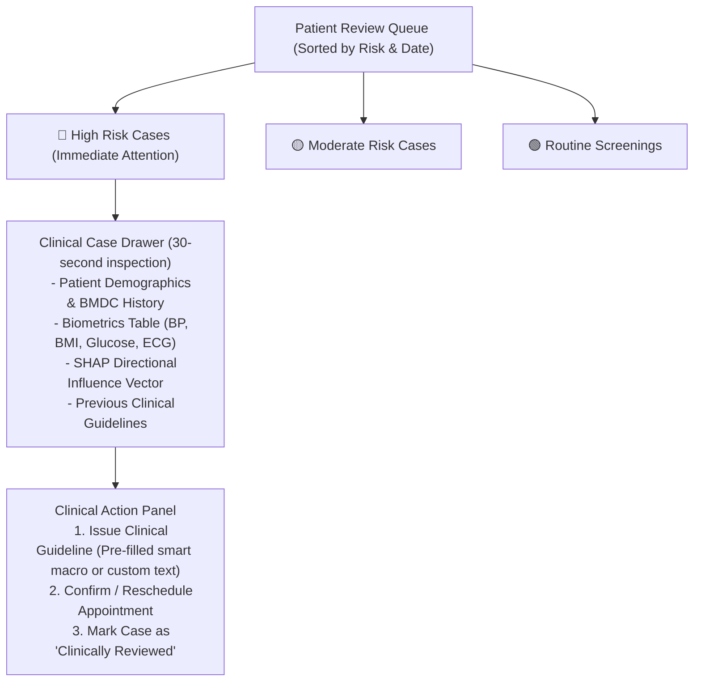

# 🩺 VitaGuard AI — Doctor & Administrator Workspace Specification (Phase 02)
**Project:** TriNexus | VitaGuard AI  
**Scope:** High-Efficiency Clinical Workflow & Governance Control Center  
**Date:** November 2026

---

## 1. Doctor Clinical Workspace (`/doctor/dashboard`)

Practicing physicians in Bangladesh—particularly in tertiary hospitals and busy private chambers—face severe time constraints. The Doctor Portal must act as an **augmented clinical assistant**, accelerating diagnostic review without usurping the physician's professional autonomy.

### 1.1 Information Architecture & Triage Queue
The primary view is the **Patient Review Queue**, ordered by clinical urgency:



### 1.2 Doctor Desktop Wireframe

```
┌────────────────────────────────────────────────────────────────────────────────────────┐
│  [Logo] VitaGuard AI · CLINICAL   কেস রিভিউ (৪)   অ্যাপয়েন্টমেন্ট (২)   নোটিশ প্রকাশ   [ডাঃ ফারহান ▼] │
├────────────────────────────────────────────────────────────────────────────────────────┤
│                                                                                        │
│  ┌──────────────────────────────────────────────────────────────────────────────────┐  │
│  │  👨‍⚕️ ডাঃ ফারহান আহমেদ (এমবিবিএস, এফসিপিএস - মেডিসিন)                               │  │
│  │  বিএমডিসি নম্বর: A-84920 | ভেরিফিকেশন স্ট্যাটাস: অনুমোদিত (Approved)                 │  │
│  └──────────────────────────────────────────────────────────────────────────────────┘  │
│                                                                                        │
│  ┌──────────────────────────────────────────────────────────────────────────────────┐  │
│  │  📋 অপেক্ষমাণ রোগীর তালিকা (Pending Patient Reviews - 4 Cases)                      │  │
│  ├──────────────────────────────────────────────────────────────────────────────────┤  │
│  │  রোগীর নাম        বয়স   স্ক্রিনিং ধরণ    ঝুঁকি স্কোর    মূল বায়োমার্কার     পদক্ষেপ      │  │
│  │  ──────────────────────────────────────────────────────────────────────────────  │  │
│  │  [🔴] মোসাম্মৎ আলেয়া  ৫৮     ডায়াবেটিস      উচ্চ (৭৪%)    BP: 160/100, BMI: 32 [কেস খুলুন] │  │
│  │  [🟡] মোঃ করিম মিয়া    ৪৫     হৃদরোগ          মাঝারি (৪৮%)   Chol: 240, SBP: 145  [কেস খুলুন] │  │
│  │  [🟡] রেহানা পারভীন   ৩৮     ডায়াবেটিস      মাঝারি (৩৬%)   পারিবারিক ইতিহাস (+) [কেস খুলুন] │  │
│  │  [🟢] তানভীর হোসেন    ৩২     ডায়াবেটিস      কম (১৮%)      BP: 120/80 (নরমাল)   [কেস খুলুন] │  │
│  └──────────────────────────────────────────────────────────────────────────────────┘  │
│                                                                                        │
│  ┌──────────────────────────────────────────────────────────────────────────────────┐  │
│  │  🔍 নির্বাচিত কেস: মোসাম্মৎ আলেয়া (৫৮ বছর, মহিলা, পাবনা)                           │  │
│  ├────────────────────────────────────────────────────┬─────────────────────────────┤  │
│  │  শারীরিক বায়োমার্কার ও ল্যাব ভ্যালু:              │  AI ব্যাখ্যা (SHAP ইমপ্যাক্ট) │  │
│  │  • রক্তচাপ: ১৬০/১০০ mmHg (গ্রেড-২ হাইপারটেনশন)     │  ▲ রক্তচাপ: +২৮% ঝুঁকি বৃদ্ধি│  │
│  │  • বিএমআই: ৩২.৪ kg/m² (স্থূলতা)                    │  ▲ বিএমআই:  +২০% ঝুঁকি বৃদ্ধি│  │
│  │  • ফাস্টিং গ্লুকোজ: ৭.৮ mmol/L (১৪০ mg/dL)         │  ▲ বয়স:    +১৫% ঝুঁকি বৃদ্ধি│  │
│  ├────────────────────────────────────────────────────┴─────────────────────────────┤  │
│  │  📝 রোগীর জন্য পরামর্শ লিখুন (Clinical Advice / Guideline):                       │  │
│  │  [দ্রুত প্রেসক্রিপশন ম্যাক্রো: উচ্চ রক্তচাপ নিয়ন্ত্রণ | ডায়াবেটিস ডায়েট চার্ট]         │  │
│  │  ┌────────────────────────────────────────────────────────────────────────────┐  │  │
│  │  │ রক্তচাপ অবিলম্বে নিয়ন্ত্রণে আনা প্রয়োজন। লবণ খাওয়া কমিয়ে দিন এবং নিকটস্থ     │  │  │
│  │  │ হাসপাতালে গিয়ে জরুরি ভিত্তিতে ইসিজি ও সিরাম ক্রিয়েটিনিন পরীক্ষা করান।         │  │  │
│  │  └────────────────────────────────────────────────────────────────────────────┘  │  │
│  │  [ ✓ রোগীর প্রোফাইলে পরামর্শ পাঠান ]        [ 📅 চেম্বার অ্যাপয়েন্টমেন্ট শিডিউল করুন ]   │  │
│  └──────────────────────────────────────────────────────────────────────────────────┘  │
│                                                                                        │
└────────────────────────────────────────────────────────────────────────────────────────┘
```

---

## 2. Administrator Governance Control Center (`/admin/dashboard`)

The administrator dashboard handles verification governance, data integrity, and compliance monitoring while maintaining complete separation from patient clinical data.

### 2.1 Core Administrative Responsibilities
1. **Physician Verification:** Verify BMDC (Bangladesh Medical and Dental Council) registration numbers and specialties.
2. **Patient Safety Oversight:** Review flagged notices or abusive reports in the community forum.
3. **Audit Trail Verification:** Monitor user authentication anomalies, administrative actions, and data deletion requests.
4. **Model Performance & Version Monitoring:** Inspect held-out metrics, test confusion matrices, and confidence intervals.

### 2.2 Admin Desktop Wireframe

```
┌────────────────────────────────────────────────────────────────────────────────────────┐
│  [Logo] VitaGuard AI · ADMIN     ডাক্তার ভেরিফিকেশন    ব্যবহারকারী    অডিট লগ    মডেল স্ট্যাটাস │
├────────────────────────────────────────────────────────────────────────────────────────┤
│                                                                                        │
│  [সিস্টেম সামারি]                                                                      │
│  • সক্রিয় রোগী: ১,২৪০ জন  | অনুমোদিত চিকিৎসক: ৪২ জন | মুলতবি ভেরিফিকেশন: ৩ জন        │
│                                                                                        │
│  ┌──────────────────────────────────────────────────────────────────────────────────┐  │
│  │  🩺 চিকিৎসক ভেরিফিকেশন রিকোয়েস্ট (BMDC Approval Queue)                          │  │
│  ├──────────────────────────────────────────────────────────────────────────────────┤  │
│  │  চিকিৎসকের নাম      বিএমডিসি নম্বর   বিশেষজ্ঞতা             কর্মস্থল          সিদ্ধান্ত      │  │
│  │  ──────────────────────────────────────────────────────────────────────────────  │  │
│  │  ডাঃ জামিলুর রেজা   A-92140         কার্ডিওলজি (এমডি)      NICVD, ঢাকা       [অনুমোদন] [বাতিল]│  │
│  │  ডাঃ সাদিয়া আফরিন   A-78310         এন্ডোক্রাইনোলজি        BIRDEM, ঢাকা      [অনুমোদন] [বাতিল]│  │
│  │  ডাঃ ফাহিম চৌধুরী    A-10492         জেনারেল মেডিসিন        কুষ্টিয়া সদর     [অনুমোদন] [বাতিল]│  │
│  └──────────────────────────────────────────────────────────────────────────────────┘  │
│                                                                                        │
│  ┌──────────────────────────────────────────────────────────────────────────────────┐  │
│  │  🔒 সাম্প্রতিক সিকিউরিটি ও অডিট লগ (System Audit Trail)                           │  │
│  ├──────────────────────────────────────────────────────────────────────────────────┤  │
│  │  সময়                ব্যবহারকারী          কার্যক্রম                  আইপি / বিস্তারিত  │  │
│  │  ──────────────────────────────────────────────────────────────────────────────  │  │
│  │  ১০ নভে, ১৪:১০:২৩   User #849 (রোগী)    নতুন স্ক্রিনিং সম্পন্ন      DiaBD নন-ইনভেসিভ  │  │
│  │  ১০ নভে, ১৩:৪৫:১২   Admin_Nishat        চিকিৎসক অ্যাকাউন্ট অনুমোদন BMDC A-78310      │  │
│  │  ১০ নভে, ১১:২০:০৪   User #312 (রোগী)    স্বাস্থ্য হিস্ট্রি মোছা     Right to Erasure  │  │
│  └──────────────────────────────────────────────────────────────────────────────────┘  │
│                                                                                        │
└────────────────────────────────────────────────────────────────────────────────────────┘
```
