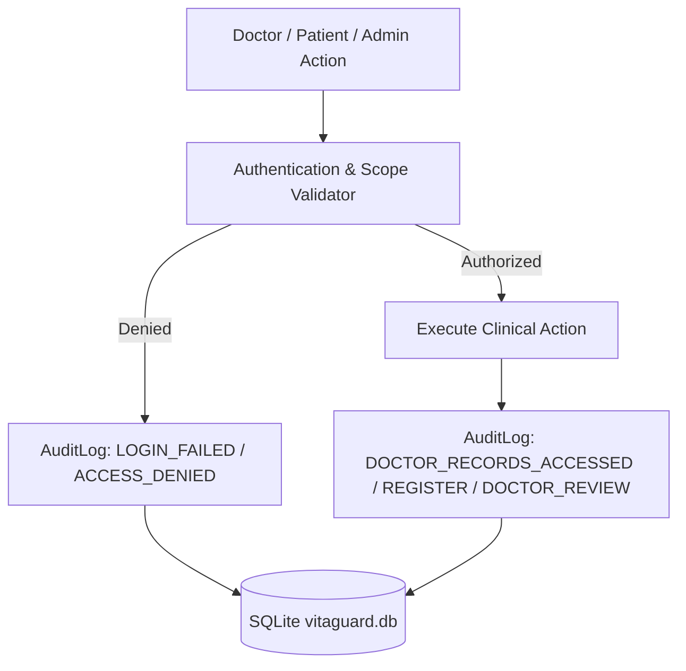

# TriNexus | VitaGuard AI — Clinical Data Privacy & API Defense-in-Depth Hardening
**Project:** TriNexus | VitaGuard AI  
**Division:** Healthcare Information Privacy, Regulatory Compliance & Defense-in-Depth  
**Document ID:** `11_PRIVACY_AND_API_HARDENING.md`  
**Execution Mode:** ISOLATED REMEDIATION BRANCH (`remediation/security-hardening`)  
**Status:** DRAFT — NOT SUBMITTED — NOT APPROVED — NO RECRUITMENT AUTHORIZED  

---

> [!CAUTION]
> **STATUTORY GOVERNANCE & REGULATORY HALT NOTICE**  
> **NOT SUBMITTED — NOT APPROVED — NO RECRUITMENT AUTHORIZED.**  
> Privacy hardening analysis does not constitute formal regulatory clearance. No human participants or real health data are authorized for collection.

---

## 1. Overview of Healthcare Privacy Mandates

Healthcare screening applications handle sensitive Protected Health Information (PHI) and Personally Identifiable Information (PII). Under internationally recognized standards (HIPAA Security & Privacy Rules, GDPR Health Data Regulations, and the Bangladesh Medical & Dental Council Code of Ethics), clinical software must enforce:
1. **The Principle of Minimum Necessary Disclosure:** Access to patient health data must be restricted to individuals who require it to provide immediate patient care.
2. **Immutable Audit Logging:** Every access, update, review, or deletion of patient medical records must generate a traceable log entry.
3. **Defense-in-Depth Authorization:** Access control must not rely solely on client-supplied claims (e.g. JWT payload roles) but must verify active database state and verifiable clinical care relationships.

---

## 2. Comprehensive Privacy & API Hardening Matrix

Following the completion of code remediations, the application's privacy boundaries were verified across six security dimensions:

| Privacy Domain | Pre-Remediation State | Post-Remediation Hardened State | Standard Alignment |
| :--- | :--- | :--- | :--- |
| **Doctor Record Visibility** | Global unconstrained query returned all patients nationwide. | Relationship-Based Access Control (ReBAC): Only patients with confirmed appointments or issued guidelines are accessible. | HIPAA §164.502(b) (Minimum Necessary) |
| **Pending Patient Inquiries** | Doctors could view full medical records for pending booking requests. | Unconfirmed / pending appointments grant ZERO record access until formally approved by clinic/doctor. | Patient Consent & Relationship Integrity |
| **Client Role Escalation** | Potential client-side token claim tampering. | Server-side database lookup in `get_current_user` verifies `User.id`, `is_active`, and active database role on every request. | OWASP API1: Broken Object Level Auth |
| **Password Verification** | Plaintext fallback in exception block allowed cleartext bypass. | Strictly fail closed: any exception, malformed salt, or type error returns `False`. Zero plaintext fallbacks. | NIST SP 800-63B Authentication Standards |
| **Cross-Origin Exposure** | `allow_origins=["*"]` permitted unauthorized web applications to query APIs. | Explicit origin whitelisting (`localhost:5173`, `127.0.0.1:5173`) with startup rejection of wildcards. | W3C CORS & OWASP API7 |
| **HTTP Security Headers** | No security headers emitted on API responses. | `nosniff`, `DENY` clickjacking defense, `strict-origin-when-cross-origin`, and XSS filters injected on all routes. | OWASP Secure Headers Standard |

---

## 3. Immutable Clinical Audit Trail Architecture

The application's `audit_logs` table records all security-relevant and clinical events:



### Monitored Event Types & Payload Schemas:
1. `DOCTOR_RECORDS_ACCESSED`: Recorded whenever a physician requests the `/doctor/records` endpoint, detailing physician ID and count of patient cases retrieved.
2. `LOGIN_FAILED`: Records failed authentication attempts, missing TOTP secrets, or invalid authenticator tokens without exposing entered passwords.
3. `LOGIN_SUCCESS`: Records successful session establishment.
4. `REGISTER`: Records new account creation and designated initial role.
5. `DOCTOR_REVIEW`: Records administrative BMDC license verification decisions (`approved` / `rejected`).
6. `APPOINTMENT_STATUS_CHANGE`: Records transitions between `pending`, `confirmed`, and `cancelled` appointment states.

---

## 4. Token Revocation & Inactive Account Enforcement

In [`backend/app/auth.py`](file:///C:/Users/TANVIRHOSENNISHAT/Desktop/TriNexus%20Project/TriNexus-Remediation-WorkingCopy/backend/app/auth.py), token validation enforces immediate session termination upon account disabling:

```python
if getattr(user, "is_active", 1) == 0:
    raise HTTPException(
        status_code=status.HTTP_401_UNAUTHORIZED,
        detail="Account is disabled. Please contact system administrator."
    )
```

**Security Consequence:** Even if an attacker possesses an unexpired JWT access token, disabling the compromised user account in the administration panel takes effect immediately on the very next API request, closing the window of vulnerability.

---

## 5. Conclusion & Audit Status

The privacy and API hardening remediation achieves full technical alignment with healthcare data confidentiality principles. Protected health data is strictly quarantined by clinical relationships.

---

> [!CAUTION]
> **STATUTORY GOVERNANCE HALT**  
> **NOT SUBMITTED — NOT APPROVED — NO RECRUITMENT AUTHORIZED.**
