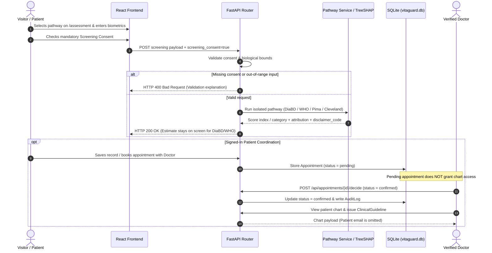

# 🩺 TriNexus | VitaGuard AI

**Explainable Screening-Support & Health-Education Workspace (Bengali & English)**

VitaGuard AI is a local screening-support and health-education application built for transparent risk exploration, explainable machine learning review, and bounded patient–doctor–administrator workflows. It keeps **four screening pathways strictly separate**. A result is **not a diagnosis**, **not a prescription**, and **not a substitute for a qualified clinician**.

> [!IMPORTANT]
> **Governance status: NOT SUBMITTED — NOT APPROVED — NO RECRUITMENT AUTHORIZED.**
>
> This status is not an institutional approval. The project does not claim BMRC or DGHS approval, a hospital partnership, clinical validation, real-world deployment, or permission to recruit patients or blood donors.

---

## 🧭 Quick Navigation

- [🚀 Quick Start & Local Execution](#-quick-start--local-execution)
- [🧬 The Four Screening Pathways](#-the-four-screening-pathways)
- [🔄 Interactive System Workflow](#-interactive-system-workflow)
- [📊 Datasets & Provenance Inventory](#-datasets--provenance-inventory)
- [💻 Frontend Architecture & Interactive Features](#-frontend-architecture--interactive-features)
- [⚙️ Backend Architecture & API Reference](#️-backend-architecture--api-reference)
- [📂 Project Structure](#-project-structure)
- [🧪 Verification & Audit Records](#-verification--audit-records)
- [👥 Contributors](#-contributors)
- [⚠️ Clinical & Technical Limits](#️-clinical--technical-limits)

---

## 🚀 Quick Start & Local Execution

### Option 1: One-Click Local Launch (Windows)

Double-click [`start-local.bat`](start-local.bat) from the root folder. It automatically:
1. Creates `backend\venv` when needed and installs `backend\requirements.txt`.
2. Creates a development `backend\.env` with a randomly generated JWT secret (and no Google client ID) if `backend\.env` is missing (it does not overwrite an existing `.env`).
3. Installs frontend packages when `frontend\node_modules` is missing.
4. Starts both the FastAPI backend (`http://127.0.0.1:8000`) and Vite frontend (`http://127.0.0.1:5173/`) and opens the browser.

### Option 2: Manual Setup (Windows / macOS / Linux)

<details open>
<summary><b>1️⃣ Start the FastAPI Backend (Terminal 1)</b></summary>

Use Python 3.14. Python 3.15 cannot install `numba` from `requirements.txt`. Git Bash on this computer may point `python` at 3.15, so create the environment with `py -3.14`.

Create the virtual environment only when `backend/venv` does not exist yet, and only from the project root. If your prompt already ends in `backend`, do not run `python -m venv backend/venv`. That creates a second folder at `backend/backend/venv`.

```bash
py -3.14 -m venv backend/venv
```

**Windows, including Git Bash.** The executable is `Scripts/python.exe`, not `bin/python`. From the project root:

```bash
cd backend
./venv/Scripts/python.exe -m pip install -r requirements.txt
./venv/Scripts/python.exe -m uvicorn app.main:app --host 127.0.0.1 --port 8000
```

**macOS or Linux**, from the project root:

```bash
cd backend
./venv/bin/python -m pip install -r requirements.txt
./venv/bin/python -m uvicorn app.main:app --host 127.0.0.1 --port 8000
```

The API command must run inside `backend`, because the Python package is `app`. Do not reuse a Windows virtual environment on macOS or Linux.
</details>

<details open>
<summary><b>2️⃣ Start the React + Vite Frontend (Terminal 2)</b></summary>

```bash
cd frontend
npm install
npm run dev -- --host 127.0.0.1 --port 5173
```

The web app at `http://127.0.0.1:5173` calls the REST API at `http://127.0.0.1:8000`.
</details>

> [!NOTE]
> **Administrator Sign-In:** Administrator sign-in also requires the current 6-digit authenticator code (TOTP) for that admin account. There is no default public admin password in this file.

---

## 🧬 The Four Screening Pathways

These pathways are **not interchangeable** and are **not one accuracy leaderboard**. Each pathway has distinct inputs, cohort boundaries, and interpretation limits.

| Pathway | Route & Endpoint | What It Is | Important Limits & Evaluation Metrics |
|---|---|---|---|
| **1. Bangladesh DiaBD** | UI: `/bangladesh`<br>API: `POST /api/bangladesh/diabetes` | A local screening index (`0–100`) on cleaned DiaBD rows, with a local **TreeSHAP** explanation of the inputs used. **Glucose is not a model input.** | **Experimental screening support.** Clean data: **5,119 rows**, **324 positives** (about 6.3%). Locked-test (1,024 rows): **accuracy 69.04%**, **precision 11.59%**, **recall 58.46%**, **290 false positives**, **27 false negatives**. Cutoff **0.51**. Low precision means a positive screen needs follow-up. Training out-of-fold recall for ages 21–40 was about **32.08%**. That age finding is not a locked-test subgroup result. |
| **2. Pima Research Table** | UI: `/predict/diabetes`<br>API: `POST /api/predict/diabetes` | A separate historical eight-measurement diabetes research form. Consented patient and guest access is open. | **Historical Phoenix-area women, ages 21–81.** Not a Bangladesh model, not a model for men or children, and not a diagnosis. The older **87.66%** accuracy is **invalid** because insulin was filled using the label. Leakage-free logistic out-of-fold **PR-AUC is 0.7166** and the **Brier score is 0.1627**. Those are not independent clinical validation. |
| **3. Cleveland Cardiovascular** | UI: `/predict/cardio`<br>API: `POST /api/predict/cardio` | A historical 13-feature cardiovascular research model, kept apart from the diabetes pathways. | **1984 catheterization cohort. 297 rows.** The locked test has **60 records**: **accuracy 91.67%**, with **32 true negatives**, **0 false positives**, **5 false negatives**, and **23 true positives**. Uses global logistic coefficients, not local SHAP. This is not general-population screening. |
| **4. WHO South Asia Chart** | UI: `/bangladesh`<br>API: `POST /api/bangladesh/cvd` | A deterministic lookup of a published 10-year non-laboratory CVD risk chart for ages **40–74**. | **Not a newly trained model.** A consistency check matched **700 of 700** tested cells. Ages **39 and 75** do not resolve. Prior heart attack or stroke stops the lookup. Table consistency is not model accuracy. A chart estimate is not a diagnosis. |

<details>
<summary>🔍 <b>Click to expand: Pathway Inputs, Feature Engineering & Explainability Details</b></summary>

### 1. Bangladesh DiaBD Non-Invasive Pathway
- **User Inputs (6 non-invasive fields):** Age (`21–80`), Sex (`0` Female / `1` Male), BMI (or Height & Weight), Systolic BP (`mm Hg`), Diastolic BP (`mm Hg`), First-Degree Family Diabetes History (`0` / `1`).
- **Derived Features (2 computed server-side):**
  - `pulse_pressure` = `Systolic BP - Diastolic BP`
  - `high_bp` = `1` if (`Systolic BP >= 140` or `Diastolic BP >= 90`) else `0`
- **Explainability:** Runs local `shap.TreeExplainer` per request ([`backend/app/services/bd_diabetes_service.py`](backend/app/services/bd_diabetes_service.py)) to compute signed directional feature contributions. Feature attribution reflects model behavior, not biological causation.
- **Calibration Status:** `uncalibrated_high_sensitivity_screening` (`screening_score_index` on a `0–100` scale).

### 2. Pima Historical Research Pathway
- **User Inputs (8 clinical/lab fields):** Pregnancies, Glucose, Blood Pressure, Skin Thickness, Insulin, BMI, Diabetes Pedigree Function, Age (`21–81`), plus mandatory `screening_consent: true`.
- **Preprocessing:** Replaces physiologically impossible zeros in Glucose, Blood Pressure, Skin Thickness, Insulin, and BMI via median imputation (`imputer.pkl`) followed by `StandardScaler` (`scaler.pkl`).
- **Access Rule:** Open to guests and signed-in patients when `screening_consent` is `true` (missing consent returns `HTTP 400`).

### 3. Cleveland Cardiovascular Research Pathway
- **User Inputs (13 referral/catheterization features):** Age, Sex, Chest Pain Type (`cp`), Resting BP (`trestbps`), Serum Cholesterol (`chol`), Fasting Blood Sugar (`fbs`), Resting ECG (`restecg`), Max Exercise Heart Rate (`thalach`), Exercise-Induced Angina (`exang`), ST Depression (`oldpeak`), ST Slope (`slope`), Fluoroscopy Major Vessels (`ca`), Thallium Scintigraphy (`thal`), plus mandatory `screening_consent: true`.
- **Explainability:** Standardized feature weights from global Logistic Regression coefficients (`cardio_model.joblib`, `cardio_scaler.joblib`).

### 4. WHO South Asia Non-Laboratory CVD Lookup
- **User Inputs:** Age (`40–74`), Sex, Smoking Status, Systolic BP, BMI, and Prior Heart Attack/Stroke screen (`prior_heart_attack_or_stroke: false`).
- **Safety Gate:** Immediately stops calculation if `prior_heart_attack_or_stroke` is `true` or age is outside `40–74` to avoid false reassurance.

</details>

> [!WARNING]
> **Provenance & Latest Research Conclusion:**
> - Dataset sampling frame and site-level provenance for DiaBD have not been independently verified from the available source documentation. The CSV has no site column.
> - Latest research conclusion: no reliable production improvement was established. Current data limitations remain, and additional representative, appropriately approved data is required. Production model files were not replaced.

---

## 🔄 Interactive System Workflow

### 1. Multi-Tier Architecture Topology

```mermaid
flowchart LR
    subgraph Client["💻 Frontend Tier (React 18 + Vite 5)"]
        UI_Public["Public Pages & Briefing Views"]
        UI_Screen["4 Separated Screening Forms"]
        UI_Roles["Role Dashboards (Patient / Doctor / Admin)"]
        UI_Edu["Knowledge Hub, Graph, Explain & Fairness"]
    end

    subgraph Gateway["🛡️ API & Security Tier (FastAPI)"]
        SecHeaders["Security Headers & CORS Middleware"]
        AuthGuard["JWT (HS256) + Bcrypt + Admin TOTP 2FA"]
        ConsentGate["Consent & Biological Range Validators"]
        CareAccess["Doctor Chart Access Gate (care_access.py)"]
    end

    subgraph Engine["🧠 Inference & Knowledge Tier"]
        DiaBD["DiaBD Classifier + Local TreeSHAP"]
        Pima["Pima Historical Pipeline (XGBoost)"]
        Cardio["Cleveland Logistic Model + Scaler"]
        WHOChart["WHO South Asia Deterministic Matrix"]
        LexicalKB["Lexical Knowledge Search & Concept Graph"]
    end

    subgraph Storage["🗄️ Persistence Tier"]
        SQLite[("SQLite (backend/vitaguard.db)")]
        Artifacts["Locked ML Artifacts (.joblib / .pkl)"]
    end

    Client -->|REST JSON / Bearer JWT| Gateway
    Gateway --> Engine
    Gateway --> Storage
    Engine -.->|Read-Only Load| Artifacts
```



### 2. End-to-End Screening & Clinical Review Sequence



### 3. Role-Based User Workflows

<details>
<summary>👤 <b>Visitor / Guest Workflow</b></summary>

1. Open `/assessment` to compare the four pathways and review their cohort limitations.
2. Run a non-invasive check on `/bangladesh` (DiaBD or WHO South Asia chart) or a consented historical form (`/predict/diabetes`, `/predict/cardio`).
3. Explore `/evaluation`, `/explain`, `/fairness`, `/knowledge`, `/knowledge/graph`, `/awareness`, `/hospitals`, `/notices`, and the labeled simulation on `/blood`.
4. Inspect public briefing views (`/presentation`, `/architecture`, `/security`, `/data`, `/governance`, `/audit`, `/pitchdeck`, `/app`, `/demo-user`, `/demo-doctor`, `/demo-admin`) without logging in.
</details>

<details>
<summary>🧑‍⚕️ <b>Signed-In Patient Workflow</b></summary>

1. Register or sign in via `/register` or `/login` and open `/dashboard`.
2. View saved screening records, doctor clinical guidelines, notifications, and privacy/consent logs.
3. Browse approved doctors (`/doctors`), book 30-minute appointment slots, or message authorized doctors (`/messages`).
4. Save a simulated donor preference on `/blood` (never added to the public synthetic list) or exercise data deletion rights (`DELETE /api/patient/my-data`).
</details>

<details>
<summary>🩺 <b>Doctor Workflow (Admin-Reviewed Account)</b></summary>

1. Register with BMDC number and specialty; wait for administrator review before clinical routes are unlocked.
2. Manage incoming appointment requests (`confirmed` / `rejected` / `completed`) and review requests on `/doctor/dashboard`.
3. **Strict Chart Access Rule:** A doctor can see a patient's record **only after a confirmed appointment or that doctor's own clinical guideline**. A pending appointment does not grant access. Patient email is not shown to doctors.
4. Author clinical guidelines and publish educational health notices (`/notices`).
</details>

<details>
<summary>🔐 <b>Administrator Workflow (Mandatory TOTP 2FA)</b></summary>

1. Sign in via `/login` using password + 6-digit TOTP authenticator code (`POST /api/auth/admin-login`).
2. Review pending doctor registrations (`approved` / `rejected`), manage user account statuses, and moderate blood network simulation rows or health notices on `/admin/dashboard`.
3. Inspect audit logs, privacy requests, and the read-only AI model & dataset governance registry.
</details>

---

## 📊 Datasets & Provenance Inventory

All datasets in the repository are documented with explicit provenance caveats, SHA-256 integrity hashes, and usage boundaries. **Zero independent external validation cohorts for DiaBD or Cleveland currently exist within the repository.**

| Dataset ID | File Path | Rows & Target | SHA-256 Hash | Current Role & Provenance Status |
|---|---|---|---|---|
| **DS-06: DiaBD Bangladesh** | [`ML_Research/Phase06B/DiaBD/diabd_raw.csv`](ML_Research/Phase06B/DiaBD/diabd_raw.csv) | 5,288 raw / **5,119 cleaned**<br>Target: `diabetic` (`324` Yes, `4,795` No; ~6.33%) | `d9f868c9ce8eefe545294156ed1626f60fdb33f507f9ca021fd34fa4b575741a` | Used for `bd_diabetes.joblib` (4,095 train / 1,024 locked test). **Sampling frame & site-level provenance unverified.** License: `NOT VERIFIED`. |
| **DS-01: Historical Pima Raw** | [`dataset/raw/diabetes.csv`](dataset/raw/diabetes.csv) | 768 rows (8 features)<br>Target: `Outcome` (`268` pos, `500` neg) | `e25ebf48cce3c03cacbbdd007e356ad0a2f7818747cf471f79371f9753869697` | Historical Phoenix-area female cohort (ages 21–81). Tied to the older target-leaked insulin imputation pipeline (87.66% figure invalid). License: `NOT VERIFIED`. |
| **DS-04: Canonical Pima Raw** | [`ML_Research/Phase06B/Pima/pima_canonical_raw.csv`](ML_Research/Phase06B/Pima/pima_canonical_raw.csv) | 768 rows (8 features)<br>Target: `Outcome` (`268` pos, `500` neg) | `698c203a14aa31941d2251175330c9199f3ccdb31597abbba2a3e35416257a72` | Used in Phase 06B for leakage-free 5-fold OOF benchmark (Logistic C=0.3: PR-AUC `0.7166`, Brier `0.1627` on 614 train rows). |
| **DS-05: Cleveland Heart** | [`dataset/raw/heart_cleveland_upload.csv`](dataset/raw/heart_cleveland_upload.csv) | 297 rows (13 features)<br>Target: `condition` (`137` pos, `160` neg) | `386015be85bcc9112cbac782dafd145aeef7abd4f8b9f2ee65f6c4c56ed82d9f` | 1984 Cleveland Clinic catheterization cohort (237 train / 60 locked test). Not general-population screening. License: `NOT VERIFIED`. |
| **WHO South Asia Chart** | [`backend/app/services/bd_cvd_chart.py`](backend/app/services/bd_cvd_chart.py) | 700 tested lookup cells<br>(Ages 40–74) | Code lookup module | Deterministic lookup table of published WHO South Asia non-lab chart cells. Redistribution: `NOT VERIFIED`. |
| **DS-09: Pabna Metadata** | [`ML_Model/evaluation/pabna_external.json`](ML_Model/evaluation/pabna_external.json) | Metadata record only (465 reported rows) | `313669b64d7f0a63824c01bb4d54b7c95e32feec8a5477f8cfa8d276a6b5cd84` | **Underlying CSV absent from disk.** Marked `UNSCORED / NOT EVALUABLE` due to measurement incompatibilities with Pima. |

<details>
<summary>📌 <b>Click to expand: Detailed Note on DiaBD Provenance & Reconciliation</b></summary>

Two descriptions exist in repository materials:
1. [`ML_Model/evaluation/bd_diabetes_metrics.json`](ML_Model/evaluation/bd_diabetes_metrics.json) cites Mendeley DOI `10.17632/m8cgwxs9s6` and repeats the published data-article description: *"63 Bangladesh unions, women and men, ages 21 to 80. Not a national sample and not WHO STEPS."*
2. An older internal inventory ([`PHASE06C0_DATASET_INVENTORY.md`](PHASE06C0_DATASET_INVENTORY.md)) described an urban outpatient survey in a BIRDEM Dhaka and Mymensingh catchment, which does not appear in the data article above.

What the CSV file (`diabd_raw.csv`) actually shows:
- Columns: `age, gender, pulse_rate, systolic_bp, diastolic_bp, glucose, height, weight, bmi, family_diabetes, hypertensive, family_hypertension, cardiovascular_disease, stroke, diabetic`.
- There is **no site, union, district, hospital, or date column**.
- Therefore, **dataset sampling frame and site-level provenance for DiaBD have not been independently verified from the available source documentation.**

See [`docs/governance/DATA_CARDS.md`](docs/governance/DATA_CARDS.md) and [`submission/final_readiness/DOCUMENTATION_CONSISTENCY_AUDIT.md`](submission/final_readiness/DOCUMENTATION_CONSISTENCY_AUDIT.md) for the full reconciliation record.
</details>

---

## 💻 Frontend Architecture & Interactive Features

Built with **React 18**, **Vite 5**, **React Router 6**, and **Tailwind CSS**, the interface is available in **Bengali and English** with `266` matched translation keys in [`frontend/src/i18n.js`](frontend/src/i18n.js).

### 1. What a Visitor Can Open (Public Routes)

| Page | Route | Component | What It Does |
|---|---|---|---|
| **Home** | `/` | [`Home.jsx`](frontend/src/pages/Home.jsx) | Overview of VitaGuard AI, governance banner, and pathway entry links. |
| **Assessment** | `/assessment` | [`Assessment.jsx`](frontend/src/pages/Assessment.jsx) | Chooses one of the four pathways. Each card states what it offers and its limitations. |
| **Bangladesh** | `/bangladesh` | [`BangladeshScreen.jsx`](frontend/src/pages/BangladeshScreen.jsx) | DiaBD screening and the WHO chart. An estimate stays on the screen until a person saves it in an account. |
| **Pima Research Form** | `/predict/diabetes` | [`DiabetesPredict.jsx`](frontend/src/pages/DiabetesPredict.jsx) | The historical eight-measurement research form. Consent is required. |
| **Cleveland Form** | `/predict/cardio` | [`CardioPredict.jsx`](frontend/src/pages/CardioPredict.jsx) | The historical cardiovascular research form. Consent is required. |
| **Model Evaluation** | `/evaluation` | [`ModelEvaluation.jsx`](frontend/src/pages/ModelEvaluation.jsx) | Shows the locked-test and research-fold numbers above. Accuracy alone is not treated as proof. |
| **Explainability Center** | `/explain` | [`ExplainCenter.jsx`](frontend/src/pages/ExplainCenter.jsx) | Explains how each pathway produces its output (local TreeSHAP vs global coefficients vs chart lookup). |
| **Fairness & Limits** | `/fairness` | [`FairnessDashboard.jsx`](frontend/src/pages/FairnessDashboard.jsx) | Displays historical DiaBD evaluation limits and suppresses subgroup metrics where approved ground truth is absent. |
| **Blood Network** | `/blood` | [`BloodNetwork.jsx`](frontend/src/pages/BloodNetwork.jsx) | A **labeled simulation**. It is not a blood bank and not a live donor network. A patient can save a simulated preference. That preference is not added to the public synthetic list. |
| **Hospitals** | `/hospitals`, `/hospitals/:hospitalId` | [`Hospitals.jsx`](frontend/src/pages/Hospitals.jsx) | A directory. Address, phone, and specialty are marked where they have not been verified. |
| **Knowledge & Awareness** | `/knowledge`, `/knowledge/articles/:articleId`, `/knowledge/graph`, `/awareness` | [`KnowledgeHub.jsx`](frontend/src/pages/KnowledgeHub.jsx), [`KnowledgeGraph.jsx`](frontend/src/pages/KnowledgeGraph.jsx), [`AwarenessSection.jsx`](frontend/src/components/AwarenessSection.jsx) | Educational notes, lexical project-note search, and a concept graph citing source paths. They do not diagnose or prescribe. |
| **Health Notices** | `/notices` | [`HealthNotice.jsx`](frontend/src/pages/HealthNotice.jsx) | Notices from signed-in doctors. The public list can be empty. |
| **Account** | `/login`, `/register` | [`Login.jsx`](frontend/src/pages/Login.jsx), [`Register.jsx`](frontend/src/pages/Register.jsx) | Email registration is open. Google sign-in works only for accounts added in that Google Cloud app. |
| **Briefing & Demo Views** | `/presentation`, `/architecture`, `/security`, `/data`, `/governance`, `/audit`, `/pitchdeck`, `/app`, `/demo-user`, `/demo-doctor`, `/demo-admin` | [`Competition.jsx`](frontend/src/pages/Competition.jsx) | Public read-only briefing views that do not sign in or modify database state. |

### 2. Role-Protected Workspaces

| Workspace | Route | Allowed Roles | Capabilities |
|---|---|---|---|
| **Patient Dashboard** | `/dashboard` | `patient` | Saved screening history, doctor guidelines, appointment booking (`Appointments.jsx`), care journey (`PatientJourney.jsx`), notifications (`NotificationCenter.jsx`), and right-to-erasure data deletion. |
| **Doctor Directory** | `/doctors` | `patient` | Lists administrator-approved doctors for booking appointments. |
| **Care Messages** | `/messages` | `patient`, `doctor` | Bounded messaging between a patient and an authorized doctor. |
| **Doctor Dashboard** | `/doctor/dashboard` | `doctor` | Incoming review requests, appointment confirmation/completion, clinical guideline authoring, and health notice publishing. |
| **Admin Dashboard** | `/admin/dashboard` | `admin` | Doctor BMDC application review, user status moderation, audit log inspection, privacy request review, and AI/dataset governance registry. |

---

## ⚙️ Backend Architecture & API Reference

The backend is built with **FastAPI** ([`backend/app/main.py`](backend/app/main.py)), **SQLAlchemy 2.0**, and a local **SQLite** database (`backend/vitaguard.db`).

### 1. Security, Privacy & Governance Controls

- **Startup Secret Verification ([`security_config.py`](backend/app/security_config.py)):** Refuses to boot if `JWT_SECRET_KEY` is missing, shorter than 32 characters, or matches a known placeholder/leaked secret.
- **JWT & Password Hardening ([`auth.py`](backend/app/auth.py)):** Passwords use `bcrypt` with strict complexity validation (12–128 chars, uppercase, lowercase, digit, special char, no username/email substring). Tokens use `HS256` with issuer `vitaguard-ai` and audience `vitaguard-api`.
- **Admin TOTP 2FA:** Administrator login requires an enrolled authenticator (`pyotp`).
- **Doctor Chart Access Gate ([`care_access.py`](backend/app/services/care_access.py)):** A doctor can see a patient's record only after a confirmed appointment or that doctor's own clinical guideline. A pending appointment does not grant access. Patient email is not shown to doctors.
- **HTTP Security Headers Middleware:** Every API response sets:
  - `X-Content-Type-Options: nosniff`
  - `X-Frame-Options: DENY`
  - `Referrer-Policy: no-referrer`
  - `Permissions-Policy: camera=(), microphone=(), geolocation=()`
  - `Content-Security-Policy: default-src 'none'; frame-ancestors 'none'`
  - `Cache-Control: no-store`

### 2. Backend Route Modules (`/api` Prefix)

<details>
<summary>📡 <b>Click to expand: Complete FastAPI Router & Service Map</b></summary>

| Router Module | Key Endpoints | Primary Service / Responsibility |
|---|---|---|
| [`routes/auth.py`](backend/app/routes/auth.py) | `POST /api/auth/register`<br>`POST /api/auth/login`<br>`POST /api/auth/admin-login`<br>`POST /api/auth/google`<br>`GET /api/auth/me` | Account registration, patient/doctor login, TOTP-enforced admin login, Google OAuth verification. |
| [`routes/bangladesh.py`](backend/app/routes/bangladesh.py) | `POST /api/bangladesh/diabetes`<br>`GET /api/bangladesh/diabetes/limits`<br>`POST /api/bangladesh/cvd` | Runs [`bd_diabetes_service.py`](backend/app/services/bd_diabetes_service.py) (DiaBD + local TreeSHAP) and [`bd_cvd_chart.py`](backend/app/services/bd_cvd_chart.py) (WHO South Asia lookup). DiaBD results are not auto-saved as prediction rows. |
| [`routes/prediction.py`](backend/app/routes/prediction.py) | `POST /api/predict`<br>`POST /api/predict/diabetes`<br>`POST /api/predict/cardio`<br>`POST /api/reviews`<br>`GET /api/doctor/reviews` | Runs [`diabetes_service.py`](backend/app/services/diabetes_service.py) (Pima) and [`model_service.py`](backend/app/services/model_service.py) (Cleveland), plus patient-to-doctor review requests. |
| [`routes/evaluation.py`](backend/app/routes/evaluation.py) | `GET /api/evaluation` | Serves locked-test and research-fold evaluation metrics, confusion matrices, and provenance notes. |
| [`routes/dashboard.py`](backend/app/routes/dashboard.py) | `GET /api/patient/dashboard`<br>`DELETE /api/patient/my-data`<br>`GET /api/doctor/dashboard`<br>`POST /api/doctor/guidelines`<br>`GET /api/admin/dashboard`<br>`POST /api/admin/doctors/{id}/verify` | Role-gated dashboards, clinical guideline issuance, doctor approval, user moderation, and personal data deletion. |
| [`routes/appointments.py`](backend/app/routes/appointments.py) | `GET /api/doctors`<br>`POST /api/appointments/book`<br>`GET /api/appointments/my`<br>`GET /api/appointments/doctor`<br>`POST /api/appointments/{id}/decide` | 30-minute slot booking, double-booking prevention (`doctor_slot` / `patient_slot` unique keys), and confirmation decisions. |
| [`routes/blood.py`](backend/app/routes/blood.py) | `GET /api/blood/requests`<br>`POST /api/blood/requests`<br>`GET /api/blood/donors`<br>`POST /api/blood/my-status` | Labeled blood network simulation. Public donors stay synthetic; matches do not return phone or email. |
| [`routes/notices.py`](backend/app/routes/notices.py) | `GET /api/notices`<br>`POST /api/notices`<br>`POST /api/notices/{id}/replies`<br>`POST /api/notices/{id}/report` | Doctor-authored educational notices, replies, and moderation reporting. |
| [`routes/privacy.py`](backend/app/routes/privacy.py) | `GET /api/privacy/consents`<br>`POST /api/privacy/consents`<br>`DELETE /api/privacy/delete-my-data` | Consent recording (`ConsentRecord`) and privacy data erasure logging (`DataDeletionLog`). |
| [`routes/platform.py`](backend/app/routes/platform.py) | `GET /api/knowledge/search`<br>`GET /api/knowledge/graph`<br>`GET /api/explain/pathways`<br>`GET /api/fairness/summary`<br>`GET /api/governance/registry` | Lexical knowledge search ([`knowledge.py`](backend/app/services/knowledge.py)), concept graph, explainability summaries, fairness metadata, and AI lineage registry ([`intelligence.py`](backend/app/services/intelligence.py)). |
| [`routes/coordination.py`](backend/app/routes/coordination.py) | `GET /api/notifications`<br>`GET /api/messages`<br>`POST /api/messages` | In-app notifications ([`notify.py`](backend/app/services/notify.py)) and bounded patient–doctor messaging. |
| [`routes/directory.py`](backend/app/routes/directory.py) | `GET /api/hospitals`<br>`GET /api/hospitals/{id}`<br>`GET /api/knowledge/articles` | Hospital directory ([`hospitals.py`](backend/app/services/hospitals.py)) with unverified-field flags and educational article catalog ([`knowledge_catalog.py`](backend/app/services/knowledge_catalog.py)). |

</details>

### 3. Protected ML Artifacts & Verified SHA-256 Hashes

All nine serialized artifacts match [`ML_Research/Competition_Readiness/ML_ARTIFACT_BASELINE.json`](ML_Research/Competition_Readiness/ML_ARTIFACT_BASELINE.json).

<details>
<summary>🔒 <b>Click to expand: Production & Research Artifact Hash Table</b></summary>

| Scope | Artifact Path | SHA-256 Hash | Size (Bytes) |
|---|---|---|---|
| **Production Runtime** | `backend/app/ml_models/bd_diabetes.joblib` | `d9a921af71c27bafa9bace696b9c590c28dbad82e8ce2935ccdc64eb0c1f38d7` | 235,255 |
| **Production Runtime** | `backend/app/ml_models/cardio_model.joblib` | `d6a975625abe80eb52a66592b9a82aa35e41b4d13f593359f8aa95ac92104f5f` | 975 |
| **Production Runtime** | `backend/app/ml_models/cardio_scaler.joblib` | `7cd6c5cc7050be779b783d786d974d27b071526e39c17f580fe2d7cfd47737a4` | 1,231 |
| **Production Runtime** | `ML_Model/models/best_model.pkl` | `b83e89714c302d128ba093cc18e0d57d988aef32d3bc9c52035852c6e802bfd5` | 243,636 |
| **Production Runtime** | `ML_Model/models/imputer.pkl` | `8e78a788b6012aae4b477d7aaa83efaeb5bda34ac725a716bb2deaa41dff6336` | 919 |
| **Production Runtime** | `ML_Model/models/scaler.pkl` | `5e204890312672ceaeddffe679e0ad3a267e5eeff280dd59931909c6cefa70a3` | 1,127 |
| **Research Only (Not Loaded by API)** | `ML_Research/Phase06B/Artifacts/diabd_research_calibrators.pkl` | `631f113737d2d023fd3ede373f36d01e27bacbac6ca8ed92bab8df2edd8840ea` | 227,960 |
| **Research Only (Not Loaded by API)** | `ML_Research/Phase06B/Artifacts/cleveland_shap_explainer.pkl` | `e7593e20eaab9e73558d2c2bcdaf1314eeb7e37aed66a439e591c2356ffb2614` | 24,803 |
| **Research Only (Not Loaded by API)** | `ML_Research/Phase06B/Artifacts/pima_leakage_free_pipeline.pkl` | `93f5188abdc4b1bec59f0a4c4ddc3abf19ffd888dd0b2628d75d5bb307ae2c7f` | 4,199 |

</details>

---

## 📂 Project Structure

```text
TriNexus-VitaGuard-AI/
├── start-local.bat                # One-click Windows launcher for backend & frontend
├── README.md                      # Interactive project guide, governance & technical reference
├── frontend/                      # React 18 + Vite 5 + Tailwind CSS interface
│   ├── src/
│   │   ├── components/            # Navbar, Footer, Appointments, NotificationCenter, ShapChart, UI primitives
│   │   ├── context/               # AuthContext.jsx & LanguageContext.jsx
│   │   ├── pages/                 # 23 page views (Assessment, BangladeshScreen, Dashboards, ExplainCenter, etc.)
│   │   ├── services/              # Axios API client (api.js)
│   │   ├── utils/                 # Role helpers & input validation schemas
│   │   ├── App.jsx                # Application router & error-bounded shell
│   │   └── i18n.js                # Bilingual dictionary (266 English & 266 Bengali keys)
│   └── package.json
├── backend/                       # FastAPI application, local SQLite file & production model bundles
│   ├── app/
│   │   ├── data/                  # Static hospital directory catalog (bd_private_hospitals.py)
│   │   ├── database/              # SQLAlchemy engine & session setup (database.py)
│   │   ├── ml_models/             # bd_diabetes.joblib, cardio_model.joblib, cardio_scaler.joblib
│   │   ├── models/                # SQLAlchemy ORM models (models.py, phase2.py) & Pydantic schemas (schemas.py)
│   │   ├── routes/                # 12 modular API routers mounted under /api
│   │   ├── services/              # 14 service modules (inference, TreeSHAP, WHO chart, care access, knowledge)
│   │   ├── auth.py                # JWT, Bcrypt, TOTP 2FA & Google token verification
│   │   ├── security_config.py     # Signing secret validation & CORS origin policies
│   │   └── main.py                # Primary FastAPI entrypoint & SecurityHeadersMiddleware
│   ├── create_admin.py            # CLI utility to provision an admin with a Base32 TOTP secret
│   ├── requirements.txt           # Python dependencies
│   └── vitaguard.db               # Local application SQLite database (do not overwrite in tests)
├── ML_Model/                      # Evaluation records for the saved models & Pima model artifacts
│   ├── evaluation/                # metrics.json, bd_diabetes_metrics.json, cardio_metrics.json, pabna_external.json
│   └── models/                    # best_model.pkl, imputer.pkl, scaler.pkl
├── ML_Research/                   # Research experiments, kept out of the production prediction path
│   ├── Accuracy_Improvement/      # Leakage-free experiments & audit reports
│   ├── Competition_Readiness/     # ML_ARTIFACT_BASELINE.json
│   ├── Model_Excellence/          # Calibration, bootstrap & fairness audit records
│   └── Phase06B/                  # DiaBD & canonical Pima research tables and research-only artifacts
├── dataset/                       # Local data files used by research and training records
├── docs/                          # Governance notes, data cards, data lineage & security proposals
├── submission/                    # Competition notes, demo scripts & final readiness audit reports
└── tests/                         # API smoke scripts (test_api.py)
```

---

## 🧪 Verification & Audit Records

`backend/vitaguard.db` is the local application database. **Tests should use a separate database path, not this file.**

- **Frontend Production Build Verification:**
  ```bash
  cd frontend
  npm run build
  ```
- **Audit & Readiness Reports:**
  - [`submission/FINAL_READINESS_REPORT.md`](submission/FINAL_READINESS_REPORT.md) — Hash verification of all nine ML artifacts, translation key parity (`266` English / `266` Bengali), and phase test results.
  - [`submission/final_readiness/DOCUMENTATION_CONSISTENCY_AUDIT.md`](submission/final_readiness/DOCUMENTATION_CONSISTENCY_AUDIT.md) — Provenance reconciliation for DiaBD, Pima access rules, and artifact checksums.
  - [`docs/governance/DATA_CARDS.md`](docs/governance/DATA_CARDS.md) — Dataset cards and license verification statuses.

---

## 👥 Contributors

| Name | Work described by the team |
|---|---|
| **Tanvir Hosen Nishat** | Model work, data review, and explainability |
| **Zayed** | Healthcare research notes |
| **Farhan** | Backend and API |
| **Siam** | Frontend |
| **Monima** | Documentation, interface writing, and presentation |
| **Fardin** | Data support |

*These are contributor descriptions. They are not clinical credentials, and they are not evidence of medical validation.*

---

## ⚠️ Clinical & Technical Limits

VitaGuard AI does not provide a clinical diagnosis. It does not name a drug or a dose. A low score is not a clearance. Positive DiaBD screens include many false positives (`precision 11.59%`, `290 false positives` on the 1,024-row locked test at cutoff `0.51`). The Cleveland and Pima numbers come from historical cohorts and small or leakage-prone evaluations, as stated above. The WHO chart is a lookup inside ages `40–74`.
