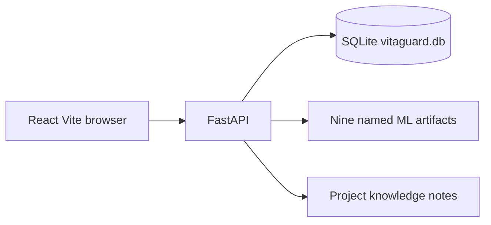

# Phase 4 competition readiness

**Governance:** NOT SUBMITTED — NOT APPROVED — NO RECRUITMENT AUTHORIZED

**Classifications:** LOCAL DEMO READY for public educational pages. COMPETITION PRESENTATION READY for the briefing pages and pitch file. SECURITY TESTED for the existing Phase A–F suites. DOCUMENTED in this file. PRODUCTION NOT APPROVED. CLINICAL DEPLOYMENT BLOCKED.

This file describes the code that is in the repository. It does not add a clinical claim.

## System

The browser uses React 18, Vite 5, React Router 6, and Tailwind. The API uses FastAPI, SQLAlchemy, and SQLite. JWT is HS256. Passwords use bcrypt. Admin login uses an enrolled authenticator.

Prediction routes and knowledge search are separate. Knowledge search reads project notes. It does not read patient rows.

## Authentication and authorization

- `POST /api/auth/register`, `POST /api/auth/login`, `POST /api/auth/google`, `GET /api/auth/me`, `GET /api/auth/google-config`
- `POST /api/auth/admin/totp/enroll`, `POST /api/auth/admin/totp/confirm`
- Tokens carry issuer `vitaguard-ai` and audience `vitaguard-api`.
- A doctor chart opens only after a confirmed appointment or an existing guideline from that doctor.
- Doctor responses do not include the patient email.
- Message bodies are not written into audit details.

## API routes that exist

All paths below are mounted under `/api` except `GET /`.

| Method | Path | Who |
| --- | --- | --- |
| GET | `/` | Public |
| POST | `/api/auth/register` | Public |
| POST | `/api/auth/login` | Public |
| POST | `/api/auth/google` | Public |
| GET | `/api/auth/google-config` | Public |
| GET | `/api/auth/me` | Signed in |
| POST | `/api/auth/admin/totp/enroll` | Admin token |
| POST | `/api/auth/admin/totp/confirm` | Admin token |
| GET | `/api/patient/dashboard` | Patient |
| GET | `/api/patient/journey` | Patient |
| GET | `/api/patient/privacy` | Patient |
| POST | `/api/patient/consent/withdraw` | Patient |
| POST | `/api/patient/deletion-request` | Patient, username confirmation |
| DELETE | `/api/patient/my-data` | Refuses deletion |
| GET | `/api/admin/dashboard` | Admin |
| POST | `/api/admin/users/{user_id}/toggle-status` | Admin |
| POST | `/api/admin/users/{user_id}/send-warning` | Admin |
| POST | `/api/admin/users/{user_id}/clear-warning` | Admin |
| POST | `/api/admin/doctors/{user_id}/review` | Admin |
| GET | `/api/admin/doctors/{user_id}/verification` | Admin |
| GET | `/api/admin/audit-logs` | Admin |
| GET | `/api/admin/privacy-requests` | Admin |
| GET | `/api/admin/security` | Admin |
| GET | `/api/admin/ai-governance` | Admin |
| GET | `/api/admin/notices` | Admin |
| POST | `/api/admin/notices/{notice_id}/hide` | Admin |
| POST | `/api/admin/replies/{reply_id}/hide` | Admin |
| GET | `/api/admin/messages/health` | Admin, counts only |
| GET | `/api/admin/appointments/overview` | Admin, no emails |
| GET | `/api/admin/demo/doctor-applications` | Admin, synthetic label |
| POST | `/api/doctor/assign-guideline` | Approved doctor with care access |
| GET | `/api/doctor/records` | Approved doctor |
| GET | `/api/doctor/reviews` | Approved doctor |
| POST | `/api/doctor/reviews/{review_id}/seen` | Approved doctor |
| POST | `/api/predict` and `/api/predict/diabetes` | Open to guests and patients when `screening_consent` is true. Cohort limit: historical Phoenix-area women, ages 21–81. Not a diagnosis. A missing consent returns 400. |
| POST | `/api/predict/cardio` | Consent required |
| GET | `/api/shap-importance` | Public global importance for the existing diabetes artifact |
| POST | `/api/reviews` | Signed in |
| POST | `/api/bangladesh/diabetes` | Consent required, not saved |
| POST | `/api/bangladesh/cvd` | Consent required, lookup only |
| GET | `/api/bangladesh/diabetes/limits` | Public file counts |
| GET | `/api/evaluation` | Public historical file |
| GET | `/api/ai/lineage` | Public |
| GET | `/api/ai/explain` | Public |
| GET | `/api/ai/fairness` | Public historical file, subgroup metrics suppressed |
| GET | `/api/knowledge/search` | Public |
| POST | `/api/knowledge/search` | Public |
| GET | `/api/knowledge/graph` | Public |
| GET | `/api/knowledge/graph/nodes/{node_id}` | Public |
| GET | `/api/notifications` | Signed-in owner |
| POST | `/api/notifications/read-all` | Signed-in owner |
| POST | `/api/notifications/{notification_id}/read` | Signed-in owner |
| GET | `/api/doctors/directory` | Signed in, approved doctors only |
| GET/POST | `/api/appointments` and the confirm, decline, cancel, reschedule, suggest, note, and complete routes | Patient or doctor as coded in `appointments.py` |
| POST | `/api/doctor/availability` | Doctor, Phase 2 table or 503 |
| GET/POST | `/api/messages/threads` and thread read/send | Patient or doctor with care access |
| GET/POST | `/api/blood/requests` and cancel, history, status, donors, locations | Role checks in `blood.py` and `platform.py` |
| GET/POST | `/api/notices` and replies and reports | Role checks in `notices.py` |
| POST | `/api/admin/blood/donors` | Admin, synthetic name required |

Request bodies are the Pydantic models in those route files. An unknown or missing token returns 401. A signed-in user without the role returns 403.

## Data

Dataset cards, lineage, and retention already live in `docs/governance/`. External licenses for DiaBD, Pima, Cleveland, and the WHO chart text remain **NOT VERIFIED**. Dataset sampling frame and site-level provenance have not been independently verified from the available source documentation. The DiaBD locked test remains accuracy 0.6904, precision 0.1159, recall 0.5846, 290 false positives, 27 false negatives, cutoff 0.51, on 5,119 clean rows and 324 positives. The invalid Pima figure is 87.66 percent. The leakage-free logistic out-of-fold PR-AUC is 0.7166, with Brier score 0.1627.

Deletion is `POST /api/patient/deletion-request`. It does not promise complete erasure. File backups of the database are kept. Encryption is not implemented. See `docs/security/ENCRYPTION_PROPOSAL.md`.

## AI

| Pathway | What it is | Explanation |
| --- | --- | --- |
| DiaBD | Uncalibrated screening index | Existing local TreeSHAP |
| Pima | Patient path forbidden | No invented patient explanation |
| Cleveland | Historical catheterization cohort | Global coefficients |
| WHO South Asia chart | Deterministic lookup, ages 40–74 | Not a trained model |

Artifact SHA-256 values are the nine entries in `ML_Research/Competition_Readiness/ML_ARTIFACT_BASELINE.json`.

The recorded synthetic DiaBD checks in `PHASE06A2_COMPATIBILITY_TEST_REPORT.md` are 66.5, 44.1, and 9.5. Phase F repeats those three calls. They are not a new study.

## Local operation

1. Backend environment file: `backend/.env` with `JWT_SECRET` of at least 32 characters, `VITAGUARD_ENV=development`, and explicit `CORS_ORIGINS`. Do not commit that file.
2. From `backend`: `venv\Scripts\python.exe -m uvicorn app.main:app --host 127.0.0.1 --port 8000`
3. From `frontend`: `npm run dev -- --host 127.0.0.1 --port 5173`
4. Copy `backend/vitaguard.db` before any approved maintenance. Restoring that copy is the recovery step. There is no separate managed backup service.
5. Logs should stay free of passwords, tokens, authenticator secrets, message bodies, and clinical measurements.
6. Public deployment, credential rotation, and schema migration are blocked until a person approves them.

## Dependency notes

No package was upgraded in this phase. `npm audit` may still report Vite and React Router advisories. Those major upgrades were not applied. Python packages were not scanned with `pip-audit` because that tool is not installed. No scan result is not a security certificate.

## Demo boundary

`/presentation`, `/architecture`, `/security`, `/data`, `/governance`, `/audit`, `/pitchdeck`, `/app`, `/demo-user`, `/demo-doctor`, and `/demo-admin` are static briefing pages. They do not sign in and they do not contain a password.

The pitch file is `docs/presentation/TriNexus_VitaGuard_AIBC_2026.pptx`.
