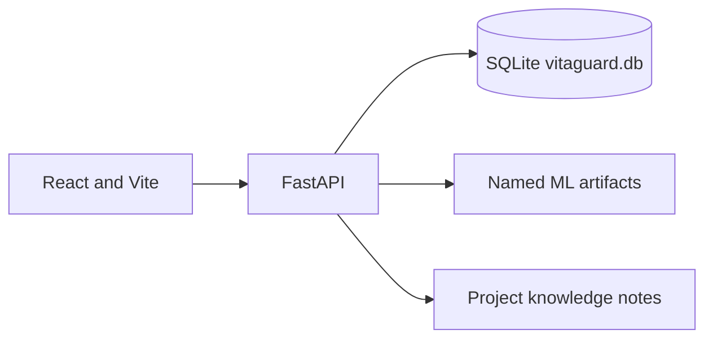

# System architecture

**Governance:** NOT SUBMITTED — NOT APPROVED — NO RECRUITMENT AUTHORIZED

## Frontend

Pages live in `frontend/src/pages`. Shared cards, buttons, and alerts live in `frontend/src/components/ui`. Routes are declared in `frontend/src/App.jsx`. Role navigation is in `frontend/src/components/Navbar.jsx`.

Public briefing routes are `/presentation`, `/architecture`, `/security`, `/data`, `/governance`, `/audit`, `/pitchdeck`, `/app`, `/demo-user`, `/demo-doctor`, and `/demo-admin`. They do not sign in.

## Backend

`backend/app/main.py` loads `backend/.env` without overriding variables already set, refuses a short or known-leaked JWT secret, and mounts the route modules under `/api`.

| Area | Module |
| --- | --- |
| Accounts | `routes/auth.py` |
| Dashboards and doctor review | `routes/dashboard.py` |
| Screening | `routes/prediction.py`, `routes/bangladesh.py` |
| Privacy | `routes/privacy.py` |
| Appointments | `routes/appointments.py` |
| Blood simulation | `routes/blood.py`, part of `routes/platform.py` |
| Messages | `routes/coordination.py` |
| Knowledge and governance reads | `routes/platform.py` |

## Database

SQLite file: `backend/vitaguard.db`. It is not part of the submission narrative as a clinical record store. Phase 2 coordination tables are defined on a separate metadata base and are not created unless `VITAGUARD_APPLY_PHASE2_SCHEMA=1`. That flag is not set. A read-only check found those tables absent.

Startup can add missing columns. It also updates a doctor row whose verification status is empty or `not_required` to `approved`. A read-only count of those rows was 0. One blood-table rebuild path runs only when `patient_id` is declared NOT NULL. The current column allows NULL, so that rebuild does not run.

## Authentication and authorization

Passwords use bcrypt. Tokens are HS256 with issuer `vitaguard-ai` and audience `vitaguard-api`. The secret comes from the environment. Administrator login requires an enrolled authenticator.

A doctor reads a patient chart only after a confirmed appointment or an existing guideline written by that doctor. A pending appointment does not open the chart. Doctor payloads do not include the patient email.

## Screening data flow

A consented DiaBD or WHO request can record pathway, consent version, language, and time. The DiaBD result from `POST /api/bangladesh/diabetes` is not saved as a prediction row. Older prediction routes may still save a signed-in screening. Knowledge search does not read patient rows.

## Response headers

API responses set `X-Content-Type-Options: nosniff`, `X-Frame-Options: DENY`, `Referrer-Policy: no-referrer`, a content security policy of `default-src 'none'`, and `Cache-Control: no-store`. HSTS is not set on local HTTP.
