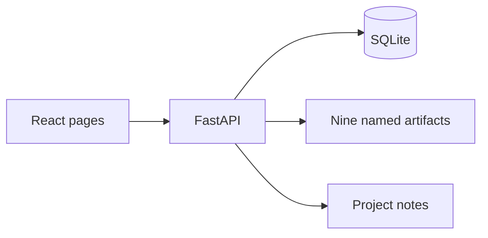

# Technical excellence and architecture

**Component:** 2 of 5, 20 points  
**Governance:** NOT SUBMITTED — NOT APPROVED — NO RECRUITMENT AUTHORIZED

## Stack

| Layer | Choice |
| --- | --- |
| Browser | React 18, Vite 5, React Router 6, Tailwind CSS |
| API | FastAPI, Pydantic, SQLAlchemy |
| Data | SQLite file `backend/vitaguard.db` |
| Auth | bcrypt, HS256 JWT with issuer `vitaguard-ai` and audience `vitaguard-api`, admin TOTP |
| Models | Existing joblib, scikit-learn, XGBoost, and SHAP artifacts. Not retrained in this work. |

Prediction routes do not call knowledge search. Knowledge search does not read patient rows.

## AI method that is actually wired

- DiaBD: `predict_bd_diabetes` loads `bd_diabetes.joblib`, scales with the bundled scaler, and explains with TreeSHAP.
- Cleveland: `model_service.py` loads `cardio_model.joblib` and `cardio_scaler.joblib`.
- Pima artifacts exist under `ML_Model/models/`. The patient endpoint is refused.
- WHO: `lookup_chart` in `bd_cvd_chart.py`.
- Retrieval: token overlap in `search_knowledge`. No embedding package is installed.
- Graph: the `GRAPH` structure in `knowledge.py`, rendered in `KnowledgeGraph.jsx`.

## Security and reliability evidence

Phase A tests cover token checks, TOTP replay refusal, cross-doctor guideline denial, and CORS. Phase B covers consent and deletion. Phase C covers platform behavior including knowledge citations. Phase D covers coordination ownership. Phase E covers empty answers, prompt-injection flagging, graph provenance, and admin-only governance. Phase F checks response headers, the nine hashes, and three recorded DiaBD profiles.

Latest separate-process run, 19 November 2026:

| Suite | Result |
| --- | --- |
| A | 14 OK |
| B | 6 OK |
| C | 7 OK |
| D | 4 OK |
| E | 7 OK |
| F | 4 OK |
| `npm run build` | Exit 0 |

There is no frontend unit-test script. ESLint is not installed. `pip-audit` was not run. `npm audit` still reports Vite and React Router advisories. Those major upgrades were not applied.

## Provenance

All nine files matched `ML_Research/Competition_Readiness/ML_ARTIFACT_BASELINE.json` on SHA-256 and byte size. The recorded synthetic DiaBD checks that still match are 66.5, 44.1, and 9.5. They are regression checks against an older compatibility note, not a new clinical study.

## What is not operational as production architecture

- Field encryption.
- Login rate limiting.
- Phase 2 tables on the production database. They stay off unless `VITAGUARD_APPLY_PHASE2_SCHEMA=1`.
- A second database for a public demo. Signing in writes `vitaguard.db`.
- The API process that was already running on port 8000 does not serve newer routes until it is restarted.

A judge should treat this as a carefully bounded local system, not as a deployed clinical platform.
